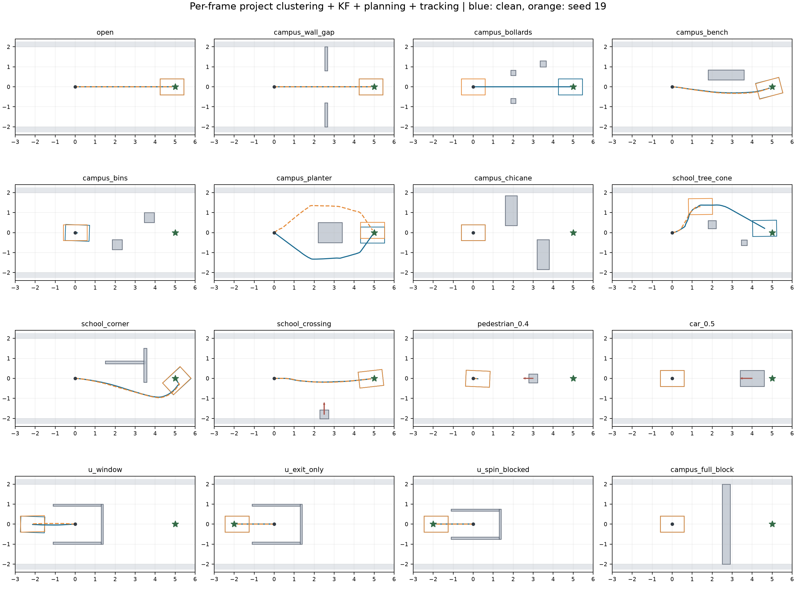
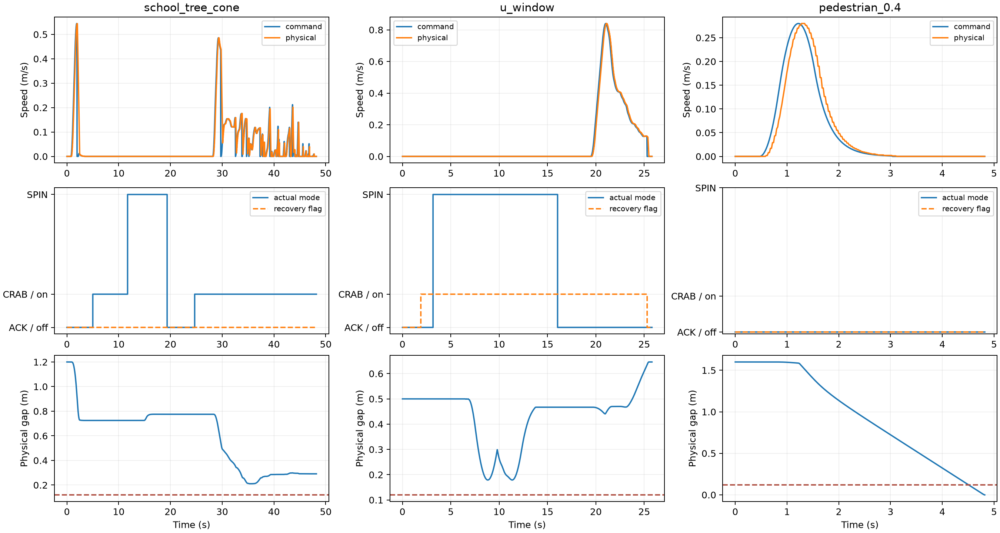

# 校园局部规划、跟踪、控制及 trap 审查（2026-11-08）

当前实现能够完成部分校园通行与 U 形退出，但本次测试不能支持“可靠校园自主避障”的结论。主要风险是迎面动态对象接触失败，以及瞬时几何无路结果被永久锁存。测试中没有观察到 ACK 与恢复标志频繁往返；恢复和模式切换的若干入口仍存在缺少确认、次数限制或故障退出的缺陷。

## 实际运行链路

`rl_dwa_car.launch.py` 启动聚类感知、规划 bridge 和轨迹 tracker；YAML 开启 `multimode_enabled=true`、`async_planning=true`、`use_atomic_plan=true`。主流程为 `LidarPerceptionCore → GlobalKFTracker → MultiModePlanner(RealtimeAckermannPlanner) → AsyncPlanner / step_multimode → TrajTrackerCore(set_plan) → ModeTransaction`。

定位输入是 1.2×0.8m 车体几何中心，ACK 内部转到后轴（偏置 0.345m），自转绕车体中心。ACK 模式 0、CRAB 模式 1、SPIN 模式 4。原 `VehicleBridgeCore.step()` 和 V-streak／ClassicTrapController 激活逻辑没有运行；`RealtimeVehicleBridgeCore._finish()` 的 `trap_active` 表示 `_recovery_goal is not None`。因此不能用 `v_streak_count=25`、`spin_count_for_trap=2` 等旧参数解释当前行为。

## 测试方法与边界

本次新增诊断脚本，没有修改生产代码。共 64 次闭环：16 场景 × 无噪声 1 次＋加噪声种子 19/37/71 各 1 次。每次最长 50s，终止于接触、目标到达，或明确终止恢复失败。初始车中心 (0,0)，前向 +x；普通目标 (5,0)，U 形出口测试目标 (-2,0)，道路宽 4m。

每帧重新生成车体系点云，通过当前地面过滤／体素连通聚类／PCA OBB／凹形分解，再转 map、执行当前 KF 匈牙利匹配；没有直接把真实物体框传给规划器，也没有重复初始聚类快照。10Hz 感知，约 0.1s 感知交付延迟；规划结果按 AsyncPlanner 的年龄、位姿和 mode epoch 规则延迟交付（至少 0.25s）；监督器 10Hz，跟踪 50Hz，车辆积分和独立多边形间距检查 100Hz；底盘命令延迟 80ms，模式事务来自重新编译的当前 C++ 头文件。噪声为点云 5mm、3%点缺失、定位约 2mm／0.002rad、定位和反馈周期抖动，另周期性丢失一帧感知。

这是平地合成点云与离线核心闭环。物体表面回波为理想密集采样，没有光线追踪、视角遮挡、坡道、湿地反射、真实行人形变或实车执行器标定；没有启动 ROS/DDS/UDP。紧急同步规划的真实计算时长会记录，但不推进虚拟运动时钟，所以动态失败证据已足以否定当前场景通过，成功结果不能外推为实车保证。

独立到达通过要求同时到达目标、没有接触且全过程物理间距 ≥12cm；完全封路正确停车单独列出。U 形前方目标在封闭墙外，退出与到达分别记录。车辆模型子步积分曾有一次 ACK 航向系数错误，先导结果已隔离到 `invalid_half_yaw_do_not_use/`，本报告仅使用修正后完整重跑；新增解析圆周轨迹、间距与坐标变换检查均通过。

## 多场景结果

| 场景 | 无噪声 | 加噪声 3 次 | 最大实际模式边沿 / 恢复标志边沿 | 最差物理净距 m |
|---|---|---|---:|---:|
| 开阔路 | 到达 | 到达 3/3 | 0 / 0 | 1.600 |
| 校门宽通道 | 到达 | 到达 3/3 | 0 / 0 | 0.400 |
| 隔离柱通道 | 到达 | 未到达 3/3 | 1 / 0 | 0.175 |
| 长椅侧绕 | 到达 | 到达 3/3 | 0 / 0 | 0.174 |
| 交错垃圾桶 | 未到达 | 未到达 3/3 | 0 / 0 | 1.152 |
| 中央花箱 | 到达 | 到达 3/3 | 1 / 0 | 0.178 |
| 交错窄通道 | 未到达 | 未到达 3/3 | 0 / 0 | 1.000 |
| 树木＋锥形路障 | 未到达 | 未到达 2/3、到达 1/3 | 6 / 0 | 0.198 |
| 建筑 L 形墙角 | 到达 | 到达 3/3 | 1 / 0 | 0.178 |
| 行人横穿 | 到达 | 到达 3/3 | 0 / 0 | 0.222 |
| 3m 迎面行人 0.4m/s | 接触失败 | 接触失败 2/3、到达 1/3 | 1 / 0 | -0.002 |
| 4m 迎面车辆 0.5m/s | 接触失败 | 接触失败 3/3 | 0 / 0 | -0.005 |
| U 形区域／前方目标 | 未到达，已退出 | 未到达 3/3；退出 2/3 | 2 / 2 | 0.179 |
| U 形区域／后方出口目标 | 到达 | 到达 3/3 | 1 / 0 | 0.498 |
| 窄 U 形区域／后方目标 | 到达 | 到达 3/3 | 1 / 0 | 0.248 |
| 道路完全封闭 | 正确停车 | 正确停车 3/3 | 0 / 0 | 1.600 |

逐次结果见 `results.csv`、`all_results.json`，轨迹／控制／KF／聚类指标在四个 `candidate*` 目录。累计 11593 帧点云中 11593 帧有效；最大检测数 176。一次前向车辆接触后结束，不把本车停车视为对持续迎面对象的成功避让。



## 是否与 trap 频繁切换

本次最大实际底盘模式切换 6 次／单场景，恢复标志最大 2 个边沿。最短相邻底盘模式命令间隔 4.68s。U 形恢复一般是一次进入、一次退出，并未出现恢复标志毫秒级／逐帧往返。其他场景的自转或 CRAB 选择不一定令 `trap_active=true`，单看 trap 日志会漏掉这些动作。

不能据此认为切换逻辑完备：`bad` 的 ACK→CRAB 分支和执行检查失败后的 ACK→CRAB 不要求 0.4s 候选持续；路线朝向自转也不要求该确认。C++ 停车、回正、回显和至少 3s 机械等待能阻止迅速发送反向模式，但不是上层抗噪声证据。树木／路障组合存在多次模式选择及停滞；逐帧意图边沿与控制跳变见 `summary.json`。



## 可复现的逻辑问题及优先级

1. **P1：单帧无路结果永久终止任务。** `multimode_supervisor.py:96–104` 只要 `guide_no_route` 且并非三方向都堵住，就置 `_recovery_failed=True`；下一帧在 54 行直接返回 `recovery_exhausted`，检测变好或动态对象离开也不重试。同一目标重新发布会被 `goal_replay_epsilon` 忽略，不能正常解锁。迎面车辆和加噪隔离柱的记录在约 0.5s 即出现这个锁存，随后停到失败。应把瞬时无路与终止失败分开，要求连续新鲜帧确认，并在障碍／路线发生实质变化时重新验证。
2. **P1：SPIN 中止与超时只改变 reason。** `multimode_supervisor.py:36–43` 在安全中止或 18s 超时后保留 `_mm_desired=4`，既不请求 ACK 返回，也不标记完成失败；安全分支在超时检查之前，还可持续屏蔽超时。`state_probes.json` 分别在 19／20／25s、以及持续危险障碍下复现。应锁存同 session 的中止／超时结果，完成受控停止及机械返回，然后进入冷却或有限重试。
3. **P1：紧急分支同步阻塞主控制回调。** `multimode_supervisor.py:73–79` 直接在父进程运行完整多模式规划；反向搜索和栅格引导没有统一 0.25s deadline，且临时把模型延迟压到 0.1s。当前样本最大紧急父进程求解 0.059s，监督器单次求解最大 0.439s，已超过0.25s（具体记录见 summary及逐次results）。应将紧急候选也放进有预算的执行链，并按实际计算／命令延迟验证。0.25s 的 YAML 值不能解释为所有求解的硬实时保证。
4. **P2：部分自转入口绕过限制。** CRAB 航向偏差 >8° 的分支（52–53 行）直接增加 `_goal_requests`，没有检查上限；探针把已用 4 次增至 5 次。`route_yaw` 分支没有 `enable_trap` 门，关闭该参数仍能请求自转。应将所有自转入口统一到同一仲裁函数，统一检查使能、次数、冷却、停止和扫掠安全。
5. **P2：感知 OBB 变化与规划几何对通道敏感。** 近方形物体的 PCA 主轴在小噪声下可显著转动，包围框会变宽；固定世界格分块又可能让动态物体的检测片数量／身份变化。`has_empty_box_area()` 仅凭盒内空面积可能把有外表面回波的实体物体判为凹形。加噪隔离柱失败、车辆出现片段检测是合成证据；真实稀疏回波需补 bag 对照。当前凹形分解已允许 U 形退出，旧报告“全部 U 被一个框封死”不再适用于当前源码。
6. **P2：安全停止破坏全程平滑上界。** 普通 ACK／CRAB 的 `speed_step` 和 `steering_step` 有加速度／jerk 限制，但 MULTIMODE_SAFETY、EXECUTION_GUARD、REVERSE_GUARD 可直接速度归零。规划 pending／stale 会被节点 healthy 白名单判为停止，容易起停。记录中同一 ACK 模式下曾从0.9935m/s指令在20ms内变成0，对应指令差分49.675m/s²；这是指令阶跃，车辆物理响应仍受模型减速限制。应区分紧急碰撞制动与短暂求解等待，保持可验证的停车轨迹；不能把普通运动段的 jerk 限制当作全程保证。

这些问题已经在当前代码或记录中复现，未为提高通过率修改 unknown 策略、缩小车身或降低间距标准。第 5 项的外推范围限于本次合成表面模型。

## 参数合理性与生效核对

| 参数 | 当前值 | 判断与建议 |
|---|---|---|
| 车长／宽／轴距，后轴转换 | 1.2／0.8／0.69m，偏置0.345m | 规划、跟踪基本一致；多模式若干位置硬编码0.345／0.69，应统一 geometry，避免以后改轴距漏改。 |
| ACK 最大转角／速度 | 30°／1.0m/s | 最小半径约1.195m，最大曲率0.837/m；最大转角处1m/s横向加速度约0.837m/s²，低于0.9限值。窄场景切 CRAB 符合可达性，但要计入切换时间。旧 `delta_max_deg=60` 不能解释当前 ACK能力。 |
| CRAB 速度／转角速度 | 0.7m/s／30°/s | 为校园侧移提供另一可达模式；必须结合真实底盘 mode=1 能力校准，本次只验证当前策略／模型。 |
| 规划／跟踪周期 | 10Hz／50Hz，3s视域、0.05s积分 | 低速静态合理起点；动态分支视域扩到5s、倒行候选7s。需给所有候选统一计算预算。 |
| planning_budget／latency／result age | 0.25／0.25／0.8s | 有独立源时间和 epoch 检查是优点；紧急同步分支绕开延迟模型。先修预算，再依据车机实测延迟分布选值。 |
| 安全间距 | 0.12m | 作为当前验收门限保留；并未包含实车定位、轮胎、形状估计的完整误差预算。不能靠调小该值解决无路或通过率问题。 |
| 指令加速／减速／jerk／转向速度与加速度 | 0.7／1.2m/s²，2m/s³，45°/s，100°/s² | 普通分支与规划模型基本相符；父 supervisor 部分安全预测硬编码jerk、delay，参数变化可能不同步；停止分支仍存在阶跃。 |
| LQR Qy／Qθ／R | 8／2／4，反馈限8° | 当前投影误差与后轴坐标合理，保留作基线；先修路径／状态机再调增益，否则更大增益无法解决无路锁存。 |
| 自适应转向预瞄 | 开阔0.4s≤0.5m；近障0.15s≤0.15m | 保留短预瞄和0.6s释放等待较合理；反馈误差没有随预瞄前移。大量路沿分块会进入复杂场景短预瞄，需评估有效相关障碍数量。 |
| speed_preview_distance | 0.0m | 代码实际用0；README中速度预瞄0.25m已过时，不能据文档认定生效。 |
| PID Kp／Ki／Kd | 0.3／0.05／0 | `wanted=min(cap,cap+PID)`使低于cap时不能通过PID提高目标，主要抑制超速。是否补偿实际执行器滞后应基于车机速度反馈标定。 |
| blocked_spin_time／motion_stall_time | 1.5／3.0s | 多模式实际位移停滞阈值硬编码2s、5cm，没有读取3s参数。统一成时间与位移门限并记录有效值。 |
| mode_confirm／gain | 0.4s／1.0s | 多条入口绕过确认，候选只比较到局部路点，不代表全任务耗时。宜先统一确认，记录确认对象／路点／模式，避免候选不同却累计同一计时器。 |
| recovery duration／retries／spin requests | 45s／2／4 | 普通恢复有边界，但部分入口绕过请求上限，SPIN等待不累计恢复时钟。修完统一仲裁后再评估45s是否过长。 |
| 机械模式等待／超时 | ≥3s／12s；SPIN请求18s | C++停车→回正→回显→机械等待顺序合理；READY明确是 timed_open_loop，回显不是实际轮组到位。测试6个模式方向均等待完成才发送运动。 |
| 点云体素／连通／最低支持 | 0.10m／0.30m／10点、跨度0.15m | 点数和轮廓对小柱／路障敏感；本次密集5mm噪声不能覆盖远距稀疏回波，需依据校园真实点云调节。 |
| 地面参考／凸凹边界 | -0.36m，±0.06m；低边界3点、跨度0.30m | 本次10cm路沿成功保留；参考高度必须对应实际base_link／传感器安装，实车重新标定。可行驶栅格发布但主规划当前没有消费。 |
| KF门限／噪声／动态确认 | 0.5m；q=0.3、r=0.15；0.3m/s连续5帧 | 有位置＋尺寸匈牙利匹配和滞回；10Hz时确认需要数百毫秒，低于阈值的移动对象按静态框处理；修无路锁存并用真实动态轨迹评估检测迟延。 |
| KF最大速度／失配TTL | 1.0m/s／3帧 | 最大速度是实际模型上界，会裁剪更快对象；TTL按处理帧而非秒，10Hz与20Hz分别约0.3／0.15s。应绑定实际周期或采用时间制。 |
| smooth_weight／sticky_eps／V-streak／trap_exit旧参数 | 0.6／0.1／25等 | 旧 EnhancedDWA／VehicleBridge 仲裁参数大量未参与当前链路；不能通过调整它们期待改善当前切换。清理或明确标记未生效参数。 |

优先顺序是修复无路锁存、SPIN异常退出及统一模式仲裁，再修实时预算／动态避让和感知几何连续性，最后用车机数据调整增益、迟延和裕度。仅调参数不足以解决已复现的状态机缺陷。

## 验证与复现

现有 `src/rda_dwa_real/test`：120 passed，1 xfailed，10 subtests passed。xfail 是项目已有“未确认运动目标按静态框输出导致迎面接触”的压力案例，不能视为该能力通过。新增测试车辆积分／独立间距／点云坐标与地面基准：3 passed。状态机5类探针均复现；C++策略测试及0／1／4六方向切换矩阵通过；实际 multiprocessing spawn 的 ACK／CRAB 工人交付检查通过。

运行依赖记录在metadata.json（本次关联使用SciPy匈牙利分支）。在工程根目录执行：

```bash
PY=diagnostics/multimode_20261108/.venv/bin/python
c++ -std=c++17 -dynamiclib diagnostics/planning_tracking_school_20261108/driver_bridge.cpp -o diagnostics/planning_tracking_school_20261108/libdriver_policy.dylib
OPENBLAS_NUM_THREADS=1 OMP_NUM_THREADS=1 "$PY" diagnostics/planning_tracking_school_20261108/run_suite.py --worker-delay .25 --duration 50 --seed 31
OPENBLAS_NUM_THREADS=1 OMP_NUM_THREADS=1 "$PY" diagnostics/planning_tracking_school_20261108/run_suite.py --worker-delay .25 --duration 50 --noise --seed 19
# 同样分别运行 --seed 37 与 --seed 71
"$PY" diagnostics/planning_tracking_school_20261108/state_probes.py
"$PY" -m pytest diagnostics/planning_tracking_school_20261108/test_harness.py -q
"$PY" diagnostics/planning_tracking_school_20261108/build_report.py
```

其他平台的C++共享库后缀／编译选项需适配。 source_sha256 用于核对当前代码；生产代码未修改。本次真实工人 smoke 同时刷新了原 multimode 诊断目录的该项结果，新目录内保存了副本。
