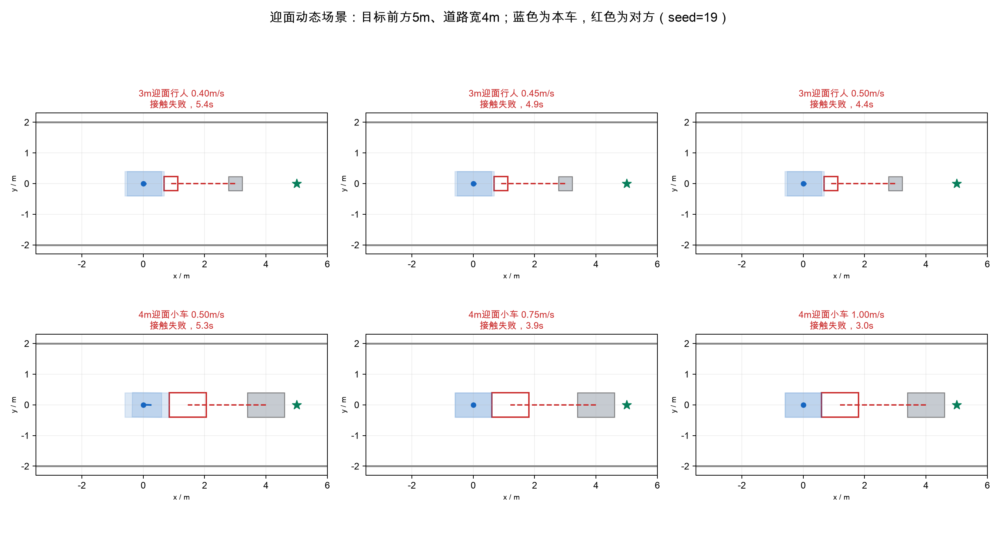
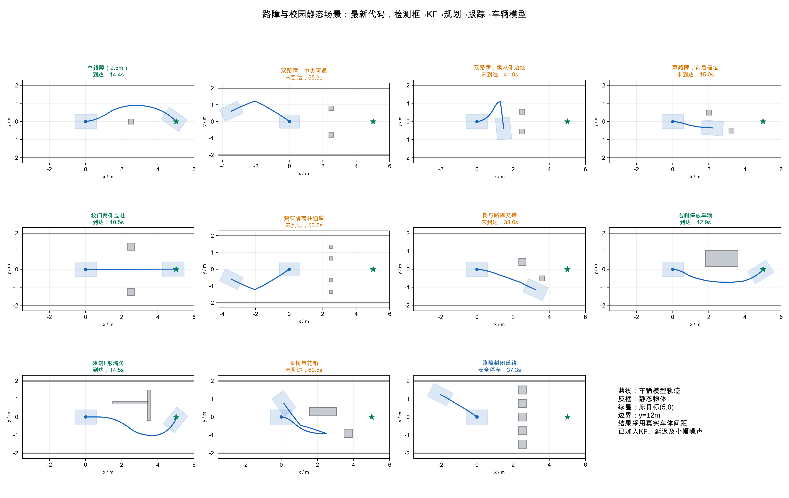
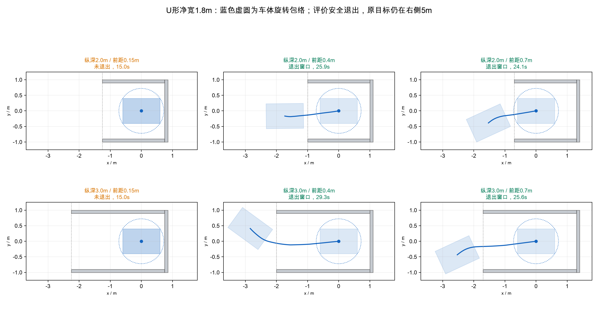
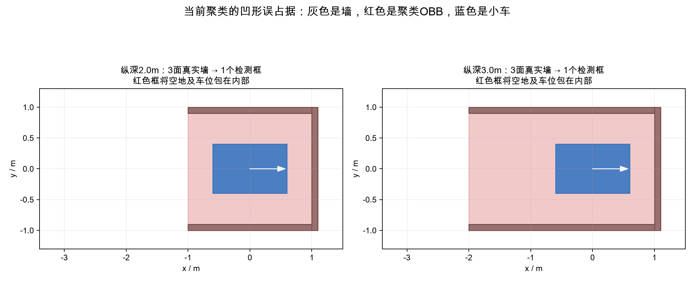
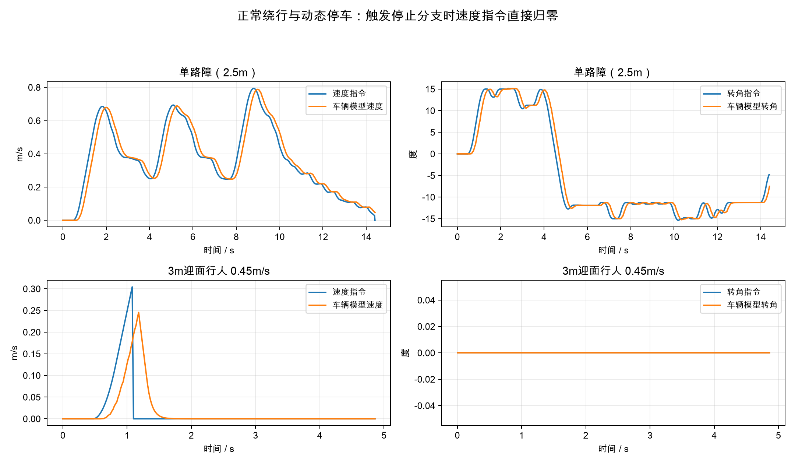

# 5米前方目标、4米道路与校园场景闭环测试

结论：当前32f65fc版本在这些场景下不能认为已实现可靠动态避障和稳定校园绕行。迎面行人/小车均发生本车停车后被持续直行对象接触的失败；单路障可以通过，双路障和部分校园组合不稳定；U形窗口的规划恢复有自转退出动作，但聚类会把凹形空地包成实心框。

## 测试边界

本次没有修改生产代码。原目标(5,0)，车体初始中心(0,0)、朝向+x，车长1.2m宽0.8m轴距0.69m。道路边界y=±2m作为静态分片框输入，宽度约束使用完整车体。迎面对象保持直线恒速，不主动避让停下的本车；因此停车本身不作为迎面避让通过。

主测试为检测框→当前KF→异步规划→50Hz跟踪→有响应滞后的车辆模型。感知20Hz、数据年龄约0.1s、规划交付延迟0.25s、底盘命令延迟0.08s，数值库线程1。噪声包含检测中心1cm、定位3mm/0.2度和检测尺寸/朝向扰动，采用19/37/71三个随机种子。物理间距由独立矩形算法100Hz检查，首次接触立即终止。正常通过要求到达且车体/障碍/道路间距均不小于12cm。

这不是实车或ROS/DDS测试，没有校准实车执行器，也没有原始实车点云回放。另做合成静态点云，经当前过滤/聚类后，把初始检测快照在map中重复送入闭环，用于检验形状占据问题；该部分不模拟视角变化或遮挡演化。

参数和源文件哈希见test_metadata.json，结果明细见primary_results.csv与all_results.json。

## 迎面动态测试

行人尺寸0.45×0.45m，目标发布时距车中心3m，速度0.40/0.45/0.50m/s；迎面小车尺寸经用户同意按1.2×0.8m，距离4m，速度0.50/0.75/1.00m/s。

| 场景 | 首次检测：加噪3次 | 提前完成KF确认：加噪3次 | 无噪声 |
|---|---|---|---|
| 3m迎面行人 0.40m/s | 3/3 接触失败 | 3/3 接触失败 | 接触失败 |
| 3m迎面行人 0.45m/s | 3/3 接触失败 | 3/3 接触失败 | 接触失败 |
| 3m迎面行人 0.50m/s | 3/3 接触失败 | 3/3 接触失败 | 接触失败 |
| 4m迎面小车 0.50m/s | 3/3 接触失败 | 3/3 接触失败 | 接触失败 |
| 4m迎面小车 0.75m/s | 3/3 接触失败 | 3/3 接触失败 | 接触失败 |
| 4m迎面小车 1.00m/s | 3/3 接触失败 | 3/3 接触失败 | 接触失败 |

所有这些迎面测试失败。触发dynamic_yield后本车速度归零，对方继续运动而接触本车，未出现成功侧移让过。提前确认对照也失败，排除了仅由unknown学习延迟解释全部失败的可能。

迎面小车的_future_refuge()采用两车外接圆判定停靠点：横向要求2×sqrt(0.6²+0.4²)+0.12=1.562m；4m道路内、正向停车车体中心最大允许偏移只有2−0.4−0.12=1.48m，形成保守判定冲突。直接检查例子：中心偏移1.2m时两个平行矩形实际净距0.4m，道路净距0.4m，却仍被圆判定拒绝。见refuge_diagnostic.json。该证据说明终端位置判定过度保守，不证明从指定起点到该停车点的完整轨迹一定可行。

行人的3m近距离场景主要是当前分段候选和制动备份没有选出可验证侧移，随后停止。测试不会把删除动态碰撞检查作为修复，也不把本车停止算作已完成避让。

## 路障和校园静态测试

路障真实底座0.28×0.28m、高0.5m。单路障位于(2.5,0)；左右路障同位于x=2.5，y=±0.8为中央可通、y=±0.55为需要侧绕；错位路障为(2,0.5)和(3.25,-0.5)。

| 场景 | 检测框加噪：到达/3 | 检测框无噪声 | 合成点云检测快照闭环 |
|---|---:|---|---|
| 单路障（2.5m） | 3/3 | 到达 | 到达 |
| 双路障：中央可通 | 0/3 | 到达 | 到达 |
| 双路障：需从侧边绕 | 1/3 | 到达 | 间距不足12cm |
| 双路障：前后错位 | 0/3 | 未到达 | 到达 |
| 校门两侧立柱 | 3/3 | 到达 | 到达 |
| 狭窄隔离柱通道 | 0/3 | 未到达 | 未到达 |
| 树与路障交错 | 0/3 | 未到达 | 间距不足12cm |
| 右侧停放车辆 | 3/3 | 到达 | 到达 |
| 建筑L形墙角 | 3/3 | 到达 | 到达 |
| 长椅与花箱 | 0/3 | 未到达 | 未到达 |
| 路障封闭道路 | 3/3正确停车 | 安全停车 | 安全停车 |

合成点云双路障侧绕与树/路障组合出现真实间距不足12cm（分别约8.7cm和7.7cm），不算通过。尖锥底座在离地高度过滤后，实测框可能只包住上方较细的截面，不能将实测尺寸误差忽略。

各校园场景的精确尺寸/坐标在runs/中保存，图中显示11种静态组合。校门立柱、停放车辆、L形墙角在检测框噪声测试3次均到达；窄隔离柱、树与路障组合、长椅/花箱未稳定完成。封闭道路正确停止。

部分失败记录出现guide_target在车后方，造成orientation_stall、自转或远距离绕行；另有规划motion但执行collision_guard反复停止。当前几何引导的额外膨胀、最多8个引导框和实际执行约束之间存在不一致；双路障中央无噪声可通过、有噪声不通过，说明引导切换对尺寸/中心扰动敏感。见failure_evidence.json。

## U形窗口是否自转退出

净宽1.8m，墙厚0.1m，纵深2/3m；车位于窗口横向中心，朝封闭端。车头到封闭端分别0.15、0.40、0.70m。原目标保持初始正前方5m；退出判据为完整车体穿过入口外侧至少0.12m，而不是已经到达原目标。

| 纵深 | 车头距封闭端 | 分开的三面墙：加噪退出/3 | 分开的三面墙：无噪声 | 当前聚类快照 |
|---:|---:|---:|---|---|
| 2m | 0.15m | 0/3 | 未退出 | 未退出 |
| 2m | 0.40m | 3/3 | 退出窗口 | 未退出 |
| 2m | 0.70m | 2/3 | 退出窗口 | 未退出 |
| 3m | 0.15m | 0/3 | 未退出 | 未退出 |
| 3m | 0.40m | 2/3 | 退出窗口 | 未退出 |
| 3m | 0.70m | 3/3 | 退出窗口 | 未退出 |

车体旋转最大半径sqrt(0.6²+0.4²)=0.721m；加入12cm间距后约需0.841m中心到墙距离（代码还加采样扫掠界）。15cm车头间距对应中心距墙0.75m，不够安全自转。当前Ackermann前进速度下限为0，没有先倒退一点再自转的恢复动作，因此这组停住。

三面墙输入正确且前距0.4/0.7m时，代码会请求自转、等待底盘模式切换、设置恢复子目标再前进退出。无噪声4种组合均退出；加噪12次中10次退出，2次恢复失败/次数耗尽。退出一般约22–29s，不能称为稳定保证。

当前聚类却把这些2–3m的连通U形三面墙当成一个OBB，最长边未达到3.5m的结构拆分门限，框包住了窗口空地和车位，6组聚类快照全部无法退出。这与真实物理碰撞不同，是感知占据几何误报。

按这里的0.1m墙厚和4m道路，两侧外绕通道各只有1.0m，而车宽加两侧间距要求1.04m。因此原目标在封闭端之外时，不能把安全退出等同于绕墙到达前方目标。此处专门记录退出事件。

## 平滑性与验证结论

正常LQR追踪段的命令加减速、jerk、转向速率/加速度满足当前参数（约0.7/1.2m/s²、2m/s³、30度/s、100度/s²）。测试数据中停止分支仍直接归零，不能把正常段的限制外推成全过程无震荡。失败场景还有反复起停/自转，车辆模型不构成实车机械平滑性证明。

优先修复方向：1）已确认动态对象的矩形停靠/时间碰撞判定和近距离侧移候选；2）凹形墙体用保留空地的分解占据表达，而不是按最长边是否大于3.5m才拆分；3）静态引导的膨胀与最终车体/执行检查保持一致，避免指向车后方或通道边缘；4）恢复加入退出目标持续条件，必要时在底盘支持下设计安全倒退；5）检测框对锥体底座的覆盖误差需要计入。

本次测试仅评估当前实现，没有为得到通过结果调整生产算法，也没有把这些失败改成通过。当前版本未达到上述全部工程场景要求。

主测试共127次：检测框噪声69次、动态提前确认18次、无噪声23次、聚类快照闭环17次；另有110次连续长边界表示对照。精确汇总以suite_summary.json为准。

本机未安装SciPy，关联使用贪心回退；Jetson有SciPy时使用匈牙利分支，具体配对可能不同。图与数据为模拟生成，测试脚本已整理为原工程内可独立运行的版本，依赖NumPy、PyYAML；出图另需Matplotlib。
