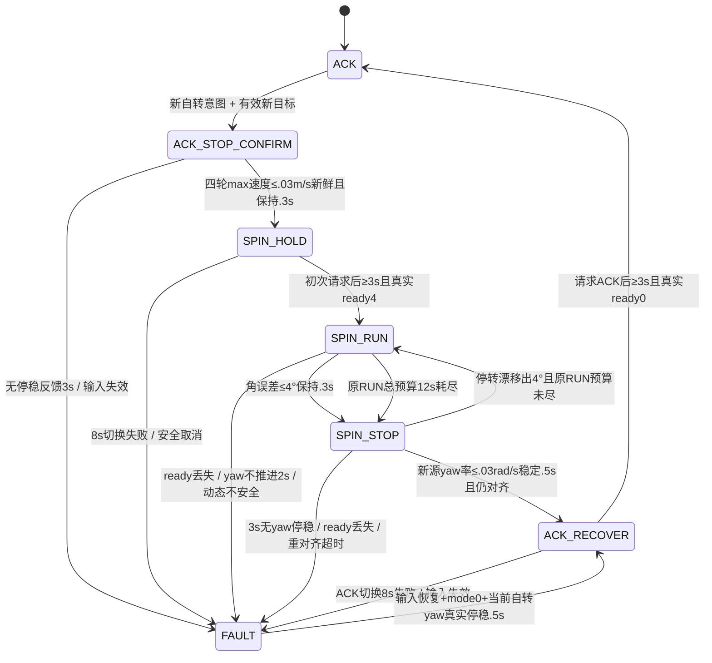
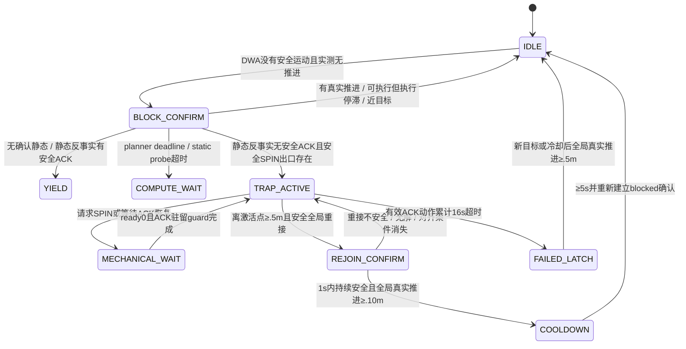
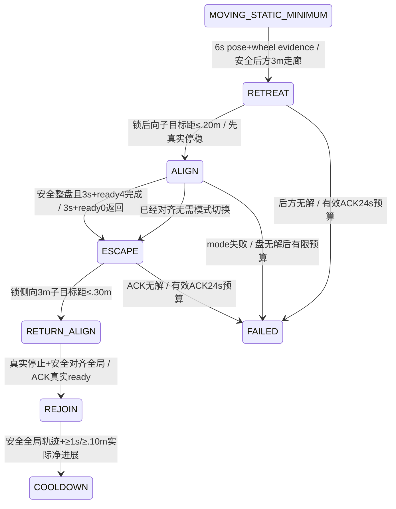

# 模式 / trap 设计、实施和对照验证

日期：2026-11-06。生产定位、TF、补偿未改；没有启动车辆。状态机为工程guard，安全依赖已建模足迹、观测源时间、障碍未来界与真实ready。有限预算保证失败有界，不保证任意凹形环境都能到达目标。

## 生产机械模式状态图

`ACK_STOP_CONFIRM`为ACK内部计时phase，不立即改变轮型；`SPIN_STOP`对应core.MODE_STOP。成功结果3在生产延迟到yaw停稳且目标仍对齐；timeout/FAULT结果4保持，普通ACK规划w=0不能结束SPIN。失败恢复也不能跳过真实停稳/ACK至少3秒+ready。底盘guard每个合法request初发+最多2次重发，补发后重新完整3秒，反馈中间态1不重发。失败后保持零指令、未就绪=-1；最终真实反馈仍可表示完成，未知模式1/2未获得生产运动许可。

| 当前phase | 转移 / 真实证据 | 发出的轮型 / 运动 | 计时 / 动态安全 / 失败 |
|---|---|---|---|
| ACK / STOP_CONFIRM | 新mode1目标，四轮速度max绝对值≤.03且fresh.3s | 0 / 0，保持ACK转角 | .3s停稳；没有轮速证据3sFAULT；planner自转候选预测涵盖停稳上界 |
| SPIN_HOLD | command4后至少3s + car_ctr ready4 | 4 / 0 | 8s机械超时；上游每帧自转全盘检查停止/机械/动作/恢复时间 |
| SPIN_RUN | 锁存目标，真实yaw误差闭环；规划w可为0 | 4 / 限幅.8rad/s、.8rad/s²命令 | RUN起点在ready后；12s与2s无进展独立；反馈丢失或动态风险立即0/FAULT |
| SPIN_STOP | 角到位先停止，真实新源yaw差分低于.03rad/s | 4 / 0 | .5s稳定且仍≤4°才成功；漂移在原RUN预算重对齐；3s无停稳FAULT |
| ACK_RECOVER | 真实停稳后请求0；至少3s+ready0 | 0 / 0 | 切换超时8sFAULT；一条新完整ACK参考才能重新运动 |
| FAULT | 新鲜有效输入+mode0，若当前轮型4先真实yaw停稳 | 原轮型 / 0；满足条件后请求0 | 未获得证据保持停车；不把故障重发变为新自转episode |

真实纵向速度标定仍缺失。max四轮轮速作为“全部低于阈值”停止观察，平均仅供方向估计；新源yaw率依赖现有定位有效性，阈值内地图修正和噪声仍需实车校准。没有实际转角反馈，所以命令角不是机械角测量。

## trap 状态图与转移表

输入断流、定位跳变、规划异常或安全取消冻结检测/重接确认，保留episode次数。实际代码IDLE/COOLDOWN/FAILED为字段状态：`_episode_failed`、`_cooldown_until`、`_trap_last_reason`、`_stall_class`；机械执行态另由`_arbit`与tracker管理。

| 分类 / phase | 进入/内部/退出依据 | 代码与失败边界 |
|---|---|---|
| 动态/unknown让行 | 主DWA blocked，但无确认静态；或去掉动态后同候选ACK仍有安全运动 | `_arbitration_step` static probe True→yield；unknown不得进入静态引导。急迫动态威胁仍由安全DWA与当前足迹决定，不能声称安全等待阻挡主动碰撞 |
| execution_stall | DWA有可执行候选、已下发非零运动，而测量不动 | 标记待核对执行停滞，不自动改轮型。轮速、执行器故障和测量问题需要日志，不冒充几何困死 |
| 计算/数据/机械故障 | 失效source、deadline、probe None、mode/ready等待 | 故障不贡献几何无解证据；planner deadline停车、机械冻结trap elapsed、最多2次episode SPIN |
| 确认静态受困 | blocked持续1.5s（测试.5）、ACK驻留2s（测试.2）、远目标、反事实静态ACK无解、当前完整SPIN及出口安全 | `_activate_trap`锁定子目标/方向；内部真实位移不刷新次数；3秒等待成本进入自转风险域；不是全局无路证明 |
| 内部动作 | 向锁定子目标DWA重规划，所有动态输入仍在安全检查 | 内部ACK有效时钟16s；SPIN/机械等待冻结；新目标显式reset；失败保留已尝试次数并冷却 |
| 重接确认 | 相对激活点位移≥.5、子目标达成或全局方向容差20°、存在降低全局目标距离的安全ACK轨迹 | `_trap_exit/_global_rejoin_safe`只是重接候选资格；REJOIN目标切全局，不再停原地计时；至少1s且实际目标距离减少≥.1后释放/5s冷却 |
| 失败锁存 | 16s有效内部动作耗尽 | trap inactive但episode failed；DWA安全正常行驶仍允许。内部侧向漂移、timeout都不重开SPIN预算；新目标或冷却后净全局进展≥.5可重置 |

## 已实现文件与参数

`vehicle_bridge.py`：控制可行性/动态yield/static反事实分类；`last_failure_reason='deadline'`消费；episode/rejoin/cooldown；LocalStaticGuide接入与near-field gate；停止/换轮/旋转/恢复整时间轴与unknown整盘、未来出口rebase；DWA/guide/probe共享周期剩余预算。

`traj_tracker_core.py`：生产ACK前真实停稳门、四轮max停止证据、新源yaw率观察、STOP稳定与原RUN预算重对齐、失败保持轮型；`traj_tracker_node.py`：bool正确声明、接受新源定位才更新yaw率、传四轮最大绝对速度。两新增门的纯legacy core默认False，**实际ROS节点和YAML均True**；离线生产harness必须显式注入模型oracle/source反馈。

`mode_switch_guard.hpp` / `car_ctr.cpp`：合法轮型0/4，未知1/2不自动接生产；`mode_max_retries=2`有界机械重发。

新参数见主统一YAML/参数总表：`trap_exit_progress=.10`、`trap_cooldown=5`、`trap_static_probe_budget=.02`、`static_search_enable=true`、`static_search_budget=.015`、`static_search_max_expansions=200`、`spin_stop_timeout=3`、`spin_require_stopped_feedback=true`、`spin_require_yaw_stop_feedback=true`、`spin_yaw_stop_rate=.03`。这些是模型/工程阈值，未经实车独立标定。

## 模块对照及边界

数据：[control_module_comparison.json](control_module_comparison.json)，脚本[compare_control_policies.py](validation/compare_control_policies.py)。两个control版本都使用当前相同planner/perception依赖，baseline control直接读取保存zip；因此这是**控制模块消融**，总体同输入基线由主报告另给。

| 相同合成输入 | 保存基线控制 | 当前控制 | 结论 |
|---|---:|---:|---|
| ±1.32m墙、合法v=.05但反馈/定位完全不动 | 1次自转（.7s） | 0，execution_stall | 消除这个明确误切模式反例，不能据此证明真实症状已消失 |
| ±1.14m墙、真正静态无ACK候选 | 1次锁存自转 | 1次锁存自转 | 保留安全受困恢复，不代表最终走出整个环境 |
| episode内部侧移.7m、次数2 | 被重置0 | 保持2 | 阻止内部漂移无限重试 |
| 同位置安全重接1.2s，无实测推进 | 退出trap | 仍active | 消除“墙钟证明进展”的逻辑错误 |
| 实测v=.2、要求自转 | .3s请求模式4 | 不请求4 | 零指令不代替真实停止 |
| 单轮.1，其他0，均值.025 | .2s后可以倒车 | 持续停 | 避免平均值掩盖未停轮 |

这个短模块trace的最大step延时为基线14.05ms、当前14.36ms，100ms deadline miss均0；p50不可直接当速度收益比较，因为错误自转时基线提前跳过DWA而当前继续滚动安全规划。当前true-blocked trace p50/p95/p99=.188/5.741/12.290ms。无ROS/DDS和车机CPU竞争。

新增C Python25项与新增C++状态机验证；旧45项控制及44项规划安全验证也通过。包括动态/unknown让行、probe超时、planner deadline、近目标、episode侧移/timeout、重接实际进展、unknown未来出口域、移动未停/单轮未停、yaw容差内仍运动、重复源yaw、停转漂移重对齐、原RUN超时、stale yaw停稳。主agent统一统计整套最终数量。

**静态liveness的负结果保留**：主集成22场景初步中，多块/U/厚U/窄U35秒仍未到达目标，虽模型未报告碰撞。局部15ms/200节点搜索与SPIN并非完整拓扑地图规划。必须按“到达/未到达、无解/超时/模式失败”分开报告，不能把no-collision换成success。

实车验收先记录真实source变化、轮速逐轮、请求与ready/驻留、yaw率与目标误差、trap原因与子目标/预算。平滑反馈或OTG下一阶段必须统一进入安全rollout并重新验证；本轮不使用jerk后滤波，不自动启用learning/CRAB/TRANSLATE。回滚由主manifest/patch/zip恢复对应运动文件和YAML，历史review备份不覆盖。

## 进一步识别移动中的局部极小：最终整合追加

原“有任何DWA安全运动就清blocked计时”正确排除了纯执行器停滞，却漏掉U形真实行驶的前后循环。新进入通道观察6秒新源轨迹窗口、实际累计路径≥.06m且最佳全局/当前锁路线进展≤.03m，并要求窗口中至少1秒**新鲜轮滚动**（四轮maxabs>.005m/s）证据。轮速在这里仅证明非零滚动，不作为独立标定纵向速度；全零或缺反馈配合1cm定位抖动不触发。交替停车/行驶不会刷新窗口，正常绕行路线真实推进得到信用。allconfirmedstatic才用该通道，动态/unknown/机械/fault冻结。

侧向3米而非2米：厚U墙外缘1.575m加车外接半径.721m及.2m余量约2.496m，2m目标仍不足。所有子目标只是指导；当前DWA完整时域、后向换向停稳、适配后复查、机械3秒+真实ready不变。两次SPIN最多，不因phase/内部位移reset；RETURN_ALIGN仍依原RUN预算，失败保持当前轮型停车。

已有静态搜索路径锁24秒TTL、6秒无路线进展失败；nearfield gate只禁止**新**路线搜索，已锁路线继续交给DWA对当前完整场景验证。新增唯一窗口参数moving_stall_duration=6；生产trap_max_duration从16升24秒以容纳后退/侧出有效ACK动作，pure默认16保留历史回归。新增阶段明显增加动作时间/模式等待，不能把复杂度本身视为收益。

故障预算修复由A独立反例验证：active RETREAT/ESCAPE遇dynamic/unknown停车让行冻结ACK计时但持续安全检查；本tick planner/hardnode deadline恢复phase/ACK预算，已请求尝试保守消费不回滚，以免计算故障无限renew。同epoch/source及控制fault下停车逻辑未弱化。新旧模式转换失败保持模式，ACK恢复超时专用锁存直到freshready0才恢复，持续mode0心跳不新开每8秒恢复循环。

**确认重接实际目标**：DWA本来会用active trap.sub_goal覆盖goal。现在REJOIN传trap=None，验证build_dynamic_window得到全局goal；只核plan入参不足以证明这一点。

匹配90秒对照存[static_recovery_90s/comparison.json](validation/static_recovery_90s/comparison.json)。和35/60秒表分开，不能跨horizon比较成功率：

| 场景（同输入90秒） | 保存基线 | 成熟阶段整合 | 净距 / trap / 模式 |
|---|---|---|---|
| U | 90秒未达，距3.381m | 83.14秒到达 | 新最小gap.618m；trap4→1、再进入3→0、模式7→4 |
| 窄U | 90秒未达，距3.629m | 82.78秒到达 | 新gap.325m；先后退，腔外两次SPIN，非窄腔强转 |
| 厚U | 90秒未达，距3.656m | 90秒距.3083m，**仍未达** | 新gap.328m，trap3→1、再进入2→0、模式6→4 |
| 多块 | 36.34秒到达 | 90秒距.9244m，**回退** | 新gap.347m；后退3m增加不必要绕行/等待，root正在选择侧绕优先修正 |

90秒这版新4场景无模型撞/余量违规、0×100/300ms deadline miss；真实车辆仍未验证。厚U.308m未达到.3m容差，不能四舍五入为成功。两组失败prototype、35/60秒成熟负结果均保留；最终默认策略与全套验证以主报告、最终源hash为准。

最终模式成本分支经主agent选择后实施：moving证据仍完整保留，且后方完整走廊必须可行；`_select_spin_target`的完整盘/等待/延迟后ACK出口安全候选若角度位于[spin_entry_deg,90°+spin_entry_deg]（当前10–100°），用现有侧向SPIN+ESCAPE_GENERIC，避免无谓3米后退。大于100°的反向/凹腔候选依旧RETREAT，窄U没有盘可行就先后退。该角度区分为工程启发式与动作/切换成本，不是几何最优或完备性结果。

实际最终多块90秒复跑见[lateral_first_final_90s/results.json](validation/lateral_first_final_90s/results.json)：仍未达，距.8097m；比总后退版本.9244m/4切换改善为.8097m/2切换、模式等待5.9秒，最小净距.2283m且无.2m余量违规，但没有恢复基线36.34秒的导航到达。该回退必须保留。后续不再迭代行为以追逐单场景数值；优先方案的正收益是U/窄U独立90秒到达与模式/预算反例，代价是某些多块布局和35/60秒截止时限下更慢。

最终wheel gate新增两独立反例：四轮全0+1cm pose cycle、缺轮反馈+pose cycle均不启动moving恢复。运动cycle的单元fixture注入与其source运动一致的模型轮速；不再把无轮滚动证据的合成pose抖动用来证明自动恢复正确。

最终hash下静态90秒完整结果见[static_recovery_final_90s/comparison.json](validation/static_recovery_final_90s/comparison.json)：基线1/4到达；最终3/4到达（U83.14s、厚U87.44s、窄U82.78s），多块仍90s距.8097m失败。三U最小净距分别.618/.328/.325m，全部零余量违规/100ms及300ms deadline miss，trap均1次且0再进入、每个完整后退episode最多2次SPIN/4次模式切换。旧厚U90s距.3083m的负试次保留，说明有限时间搜索/局部跟踪在接近.3m容差时存在试次变化；不能用最后一次成功覆盖它。新目录记录准确控制源hash；两版本同合成输入/物理模型/90秒期限，ROS车机联调和实车仍未做。

## 最终默认选择：自动移动恢复关闭，保留观测和实验

上述自动moving恢复试验**不作为最终默认行为**。多块布局从基线36.34秒到达变为90秒未达，是显著导航回退。进一步实验[control_confinement_probe.json](control_confinement_probe.json)用goal法向两侧各2m、保持当前yaw的实际矩形足迹采样及段间sweep，确认三U两侧都blocked、多块两侧free。它是几何触发条件，不是可执行侧移，也没有用长墙外接圆作判定。

然而[confinement_experiment/results.json](validation/confinement_experiment/results.json)多块90秒仍未达（距3.3502m，零trap/模式切换、gap.3468m），说明“几何区分正确”不足以恢复默认导航性能。没有继续调时间或放宽安全条件追逐这个场景。

因此最终 `moving_recovery_enable=False`：默认只输出具有pose+wheel证据的moving minimum观测，原始confirmed-static无安全ACK候选的有界恢复仍保留；默认稳定guard、perception、collision kernel改进启用。`moving_recovery_enable=True`作为明确实验开关，并要求两条goal-normal固定yaw2m足迹走廊都受阻，才允许后退/侧出自动恢复。开放侧绕不会因moving判据自动进入后退episode。上述83–87秒U收益与多块回退保留为历史实验结果，不宣传为默认收益。

新默认关闭/观测继续、实验开启+真实wheel cycle、open空间不自动恢复、零wheel或缺wheel+1cm jitter不触发、rear阻塞、窄U先后退和原static-blocked恢复共同验证。最终源hash与默认选择记在control_frozen_manifest.json，主报告按最终配置运行默认基线对照，历史实验源码hash均保留。
