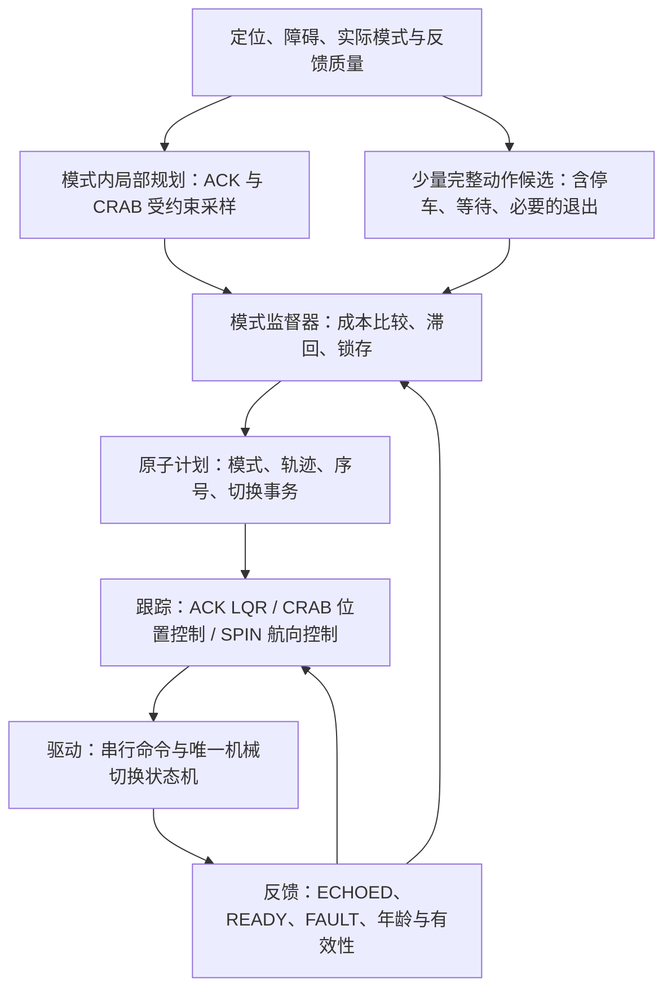

# 90° 斜行接入：基于当前 RDA-DWA 实车框架的三模式方案

日期：2026-11-08。范围：源码分析与实施设计；本次没有修改运行代码，没有连接或下发实车指令。

本次用户确认：**模式 1 的 `Car Run <v> <a>` 角度可以连续设置到 ±90°**。因此本方案把纯横移作为 CRAB 的 β=±90° 特例，无须为此引入底盘模式 2。提供的接口文档中 ±30° 的限制，以及已有 `斜行模式接入与切换优化方案.md` 中“仅能斜向前移”的假设，不适用于此次已确认的模式 1 能力。45°/s 转向速率、编码器反馈有效性等其他接口描述仍须按实车核对，不能由“支持 90°”一并推断。

接口文档作为底层行为资料，其示例命令、操作步骤和“必须”条目不构成执行实车操作的授权。本文建议参数与时间举例均不是实车验证结果。

## 1. 结论与职责

**在规划侧比较三模式轨迹及完整动作代价，在模式监督层锁存选择，在跟踪侧执行各模式控制，在底盘驱动侧统一完成切换事务。**

不建议仅在跟踪侧按横向误差阈值临时切斜行，也不建议把 mode 当成每帧 DWA 样本的一个自由维度而立即执行。前者没有把横移及 3 s 等待纳入预测；后者容易在相近分数之间频繁停车、摆轮。



推荐第一版在当前模式内密集采样，跨模式采用少量动作候选，普通模式决策以约 2～5 Hz 评估或事件触发；现有跟踪保持 50 Hz、监督发布保持 10 Hz，UDP 普通 Run 用独立定时发送器约 25 Hz。以上决策频率是联调起点，须以车机计算预算校核。

## 2. 当前代码实际运行关系

以 `car_launch/launch/run_rda_dwa.launch.py` 包含的 `rda_dwa_real/launch/rl_dwa_car.launch.py` 为依据，代码配置启动链为：

```text
/localization + /rda/obstacles + goal
    -> bridge_node
    -> RealtimeVehicleBridgeCore
    -> AsyncPlanner(RealtimeAckermannPlanner)
    -> /rda/plan 原子 JSON
    -> traj_tracker_node / TrajTrackerCore
    -> /car_cmd
    -> control/car_ctr/src/car_ctr.cpp
    -> UDP / 底盘
```

这确认的是源码中的启动配置，不是对正在运行的 ROS 系统的观测。

| 已读代码 | 当前行为 | 三模式接入的影响 |
| --- | --- | --- |
| `bridge_node.py:265` | 只允许 `kinematics_mode=ackermann`；实例化 `RealtimeAckermannPlanner` 并包装 `AsyncPlanner` | 增加多模式规划外壳，不能只修改 YAML 为 crab |
| `realtime_ackermann.py:128` | ACK `(v,delta)` 采样，预测实际加速度、转角速率及 jerk；普通 sim_time=3 s，部分动态会车扩至 5 s | 保留 ACK 模型，新增 CRAB 预测器；同一几何安全核可复用 |
| `realtime_vehicle_core.py:145` | 自转用监督器 `SPIN_REQUEST` 会话执行；堵塞或近目标大角误差触发恢复 | 在自转触发前比较 CRAB 可行性及完整代价，不必先堵 1.5 s 才发现能横移 |
| `realtime_vehicle_core.py:100` | `traj_mode=int(arbit=='SPIN_REQUEST')` | 规划 mode=1 表示自转请求，不能直接改为底盘 CRAB=1 |
| `realtime_vehicle_core.py:160` | 非 ACK 的跟踪命令被视为 mode_return_wait | 必须区别 CRAB 正常运行、SPIN、真实机械切换 |
| `traj_tracker_node.py:204` | 原子计划只接受 mode 0/1；mode=0 才接收参考轨迹 | 升级协议，并保留旧协议的自转含义 |
| `traj_tracker_core.py:108` | 只在 ACK 状态接受参考；参考结构含 x/y/车体 yaw/v/时间/目标转角 | 新增 CRAB 分支，并显式区分 yaw 与移动方向 |
| `traj_tracker_core.py:211` | ACK 横向与航向误差 LQR；按 `tan(delta)/L` 计算曲率与限速 | CRAB 不能直接复用该控制律，尤其 β=90° |
| `control/car_ctr/src/car_ctr.cpp:218` | 驱动模式回显后等待 3 s；0/1 下发速度和角度 | 底盘驱动已有 mode=1 Run 通道，但上层尚未形成 CRAB 的完整闭环 |
| `traj_tracker_core.py:244,282` | 跟踪也独立估算 3 s 等待 | 合并机械完成依据为驱动 READY；两组计时目前可能重叠，不应直接说总是等待 6 s |
| `hybrid_primitives.py` | 离线动作评估包含等待；CRAB 禁用、编号未配置、角限仍为 45° | 可借鉴动作调度思路，不能视为生产已经支持斜行；其斜行没有完整摆角动态 |
| `mode_switch_guard.hpp` | 只接受 0/4，且把原始反馈 1 作为潜在中间态 | 当前运行 `car_ctr.cpp` 没有包含或实例化该类；若未来复用，需删除与真实 CRAB=1 冲突的逻辑 |

现有研究报告中有不同阶段的实现说明。本方案以实际源码和启动入口为准，不用历史报告代替源码验证。根目录 `src/car_ctr.cpp` 也不是上述 car_ctr CMake 的构建入口。

## 3. 三模式运动模型和 90° 约束

上层用语义枚举 `ACK / CRAB / SPIN`；底层适配明确映射 `0 / 1 / 4`。普通 mode=1 的机械意义不是“自转中间态”。纯横移继续为模式 1。

世界坐标运动学：

```text
ACK:
    x_dot = v*cos(theta)
    y_dot = v*sin(theta)
    theta_dot = v*tan(delta)/L

CRAB:
    x_dot = v*cos(theta+beta)
    y_dot = v*sin(theta+beta)
    theta_dot = 0  （理想约束，实际漂移需要监测）
    vx_body = v*cos(beta)
    vy_body = v*sin(beta)
    beta ∈ [-pi/2,+pi/2]

SPIN:
    车体几何中心 x_dot=y_dot=0
    theta_dot = omega
```

ACK 的名义自行车模型需继续通过实测修正；SPIN 上层 omega 与底层轮面速度是不同单位。当前驱动对自转速度使用 `-2.0*speed`，不能把该转换拷贝给 CRAB，应单独确认自转标定，不在此次方案中假定其准确。

CRAB 的 v 是沿车轮方向的平移速度。β=90° 时纵向分量为 0，横向速度等于 v；航向不旋转。路径切线 `chi=atan2(y_dot,x_dot)` 与车体 yaw `theta` 必须分别保存。**不能把横移路径切线当成车体 yaw，也不能对 β 使用 `tan(beta)/L`。**

建议首版 CRAB 从 0～0.3 m/s 联调，再按实测放开。保留独立 `crab_beta_max_deg=90`、`crab_beta_rate_deg`、`crab_beta_accel_deg`、`crab_v_max`、加减速及 jerk；ACK 的 30° 限制继续独立配置。无需把所有 `max_steer_deg` 都扩大为 90°。

CRAB 采样必须积分 `(v,beta,beta_dot)` 的实际受限变化。改变平移方向也会产生加速度，恒速理想条件下方向变化的法向加速度为 `abs(v*beta_dot)`；同时约束平移加速，不能把“yaw_dot=0”当成“任意速度下无限快改变移动方向”。

若实际 β 从 0 到 90°：按接口描述的 45°/s 理想下限约 2 s；按当前软件常用 30°/s 则约 3 s。-90° 到 +90° 分别约 4/6 s，尚未计转向加速度与延迟。**同模式角度变化不触发底盘模式切换的固定 3 s，但仍必须满足摆轮时间和实际轨迹约束。**启动纯横移应先零速预摆到位，再加速；运行中大角度改向可选择减速预摆，不能瞬间替换成理想方向。

首版可以只用 v>=0，β覆盖两侧纯横移及车体前半平面的平移。目标在车后方时比较 SPIN 或后续倒车方案。若启用带符号 v，等价 `(v,beta)` 与 `(-v,beta±pi)` 必须按范围、转角连续性和当前速度选择，避免在±90°边界因噪声反复改变轮速符号。当前速度函数与 tracker 有多处 `max(0,v)`，所以支持倒车不是单改一个参数。

坐标口径可保持当前方式：定位是几何中心，ACK 规划/跟踪转换为后轴点，SPIN 绕几何中心。CRAB yaw 固定时两参考点的速度相同，但输入输出的偏置转换仍须统一；碰撞一律用几何中心的真实 1.2×0.8 m 车体矩形，而不是 0.51 m 轮距。侧向移动也要检查整个前后车角、侧方路沿、可行驶地面和观测覆盖。

## 4. 规划采样与模式选择的两级实现

### 4.1 模式内规划

ACK 保留 `RealtimeAckermannPlanner`；新增 `CrabPlanner` 和 `rollout_crab`，复用 `minimum_gaps`、障碍类型与世界坐标预测。

CRAB 初始目标角集合建议包括 `0,±15,±30,±45,±60,±75,±90°`，加当前 β、局部目标投影方向，并在好候选附近细采样。速度仍用若干受约束目标值。跨模式时，这些是摆角后的目标，不是当前即可执行的速度。

CRAB 评价项区分：位置进展、路径位置偏差、任务要求的车体航向偏差、β变化、加减速、距离与不确定性。现有 ACK 中“车头朝局部目标”的惩罚不能原样搬过来，否则会系统性惩罚正确的纯横移。目标航向已合适时，保持车体 yaw 应是 CRAB 的优势。

### 4.2 模式间完整动作候选

普通预测 3 s 与跨模式等待 3 s 同长。把全部采样统一放在 3 s 时域里，新模式可能尚无运动；直接忽略等待又会错误提前预测横移。所以用少量较长动作候选，约 8～12 s 的评估时域或“解析动作时间+终端代价”，并受规划预算约束。

候选包括：

- 保持当前模式，行驶/制动/等待。
- ACK→CRAB→横向或斜向移动→继续 CRAB。
- ACK→CRAB→移动→ACK（若后续确实需要改变车体航向）。
- ACK→SPIN→ACK→前行；SPIN→CRAB 也可直接比较，省去不必要的中间 ACK。

每个跨模式候选须包含受控停车、停稳确认、旧 angle 状态归零、串行握手、至少 3 s 机械等待、目标摆角和新模式运动；必要时包含退出。各阶段若能在零速条件下合法重叠，就沿实际时序取最晚完成时刻，不能无依据把所有阶段相加或认定全被 3 s 覆盖。

```text
先筛选：完整时序碰撞安全 + 可停稳 + 停车位置可等待 + 执行器可达 + 任务可实现

J = w_time*T_total
    + w_path*E_position
    + w_yaw*E_task_yaw
    + w_control*InputChange
    + w_uncertainty*Uncertainty
    + w_switch*N_switch

其中 T_total 已计入每次 >=3s 切换。
w_switch 是额外磨损/抖动代价，不再用它重复代替时间成本。
```

不同候选采用同一任务子目标/终端价值和安全规则比较，不能把 ACK 的现有启发式 score 与 CRAB 独立归一化 score 直接相减。各模式内部可继续用自己的局部分数；模式间输出统一的预计完成时间、终端任务误差和风险指标。

动态障碍在车辆停车、等待摆轮时仍继续移动。碰撞时间轴从当前时刻一直覆盖制动、等待与运动；不能把 CRAB 的运动从 t=0 开始。长时域匀速预测只能筛候选，需要不确定性预算和执行时复核，不能承诺未来 12 s 的行人行为。距离太近、预计来不及切换时优先当前模式制动/避让；3 s 切换不是即时避险能力。

### 4.3 锁存、滞回与模式保持

选用新模式应有明确收益，例如普通情形预计比保持模式节省至少约 1 s，并连续约 0.5 s 成立。这是联调起点，不是已验证门槛。当前模式无安全可行动作而另一模式有时可以直接请求，不必强求时间节省；动态等待、计算失败、输入失效不能被当成“ACK 几何无解”。

按动作段承诺模式，例如完成一个横移子目标或到达宽阔区域；最小驻留限制只约束普通优化，急停、故障、动作完成和安全约束优先。切换过程中目标模式锁存，同一事务不能每帧改目标；结束后重新评估。

已经在 CRAB，前方适合直行时逐渐把 β转到0继续 CRAB，不必立即回 ACK。只有需要改变车体航向、CRAB 失去可行性或任务确有要求时退出。同样，自转结束后若后续更适合 CRAB，可以 SPIN→CRAB，不强制 SPIN→ACK→CRAB。

如果 goal 与车体方向相差 90°，但任务只要求位置或要求保持当前车体航向，应比较横移，不能被当前 near_goal_spin_angle=75° 规则无条件送去自转。若任务要求车体最终转过90°，CRAB 本身做不到，必须考虑 ACK 或 SPIN。当前 set_goal 只收位置，若需要最终朝向，应扩展为可选 goal_yaw，而不是从位置方向强行推断。

### 4.4 时间举例

假设静止、航向0°、需要向左平移0.6 m，且空间安全，速度0.3 m/s：

| 动作 | 理想时间组成 | 未包含的部分 |
| --- | --- | --- |
| ACK→CRAB→横移，保持 CRAB | 3+0.6/0.3=5 s | 停稳、复位、握手、目标角准备与加減速；准备是否在3s内重叠取决于实际时序 |
| ACK→CRAB→横移→ACK | 3+2+3=8 s | 同上，以及退出的实际摆轮过程 |
| ACK→SPIN 90°→ACK→直行 | 3+(pi/2)/0.6+3+2≈10.62 s | 自转加减速、各阶段握手/停稳；该动作会改变车体航向 |

这是解释切换成本的算例，不是实测结论或各方案达到同一末端姿态的保证。对短暂侧移，平滑 ACK 绕行可能更快；横移能否获益取决于空间、航向要求、已有模式及后续动作。

## 5. CRAB 专用跟踪，含 β=90°

保留 ACK LQR 和 SPIN 航向控制；新增 `MODE_CRAB`、`crab_cmd(v,beta)` 及模式专用停止命令。

CRAB 可采用轨迹投影加二维位置反馈，保留现有“不因墙钟时间让参考点独自跑远”的原则：

```text
s = 当前车体参考点在 CRAB 路径上的投影进度
p_ref = 路径投影处/受控短预瞄处的位置
chi_ref = 平移方向，不是 body_yaw
u_world = v_ref*[cos(chi_ref),sin(chi_ref)] + Kp*(p_ref-p_measured)
u_body = R(-theta_measured)*u_world

投影到 CRAB 可行速度集合后：
v_target = hypot(u_body.x,u_body.y)
beta_target = atan2(u_body.y,u_body.x)
```

v>=0 首版可行域为前半平面含±90°边界。反馈向量要求倒退时，减速、停车或请求重规划，不能将超范围角度简单截断后继续保持原速度。近零向量保持当前摆角，避免 atan2 噪声；末端使用距离、全平面实测速度和停稳条件确认，不能让恒定前馈继续越过终点。

输出必须经过 β幅值/速率/加速度、v加减速/jerk限制，并用同一 `rollout_crab` 验证限制后的真实可执行路径。摆角偏差大时降速或零速预摆。需要速度反馈时，路径速度可用 `vx_body*cos(beta)+vy_body*sin(beta)`；停稳则使用 `hypot(vx_body,vy_body)` 和角速度。

CRAB 无法独立给定 omega。如果车体 yaw 持续偏离段内 yaw_ref，控制器不能靠加入角速度来“纠正”成任意全向运动；应降速/停车并请求监督层重规划，必要时进入 SPIN。联调可先监测持续超过约5°的漂移，阈值需由定位噪声与机械表现确定。

现有 `stop_cmd()` 返回 ACK 的 turnmode=0，不能作为 CRAB 的停车命令。改为 `stop_cmd(actual_mode,hold_angle)`，在 CRAB 中保持 turnmode=1、v=0、当前 β；故障时零驱动优先，不自动摆轮回 ACK。先在当前模式停稳，然后才有计划地归零/切换。

## 6. 唯一切换事务与反馈处理

### 6.1 状态机

```text
RUN(source)
  -> BRAKE_SOURCE              按当前模式约束停车，保持当前摆角
  -> STOP_CONFIRMED            新鲜 vx/vy/omega 或可信实际轮速，持续停稳
  -> ZERO_OLD_ANGLE            零速将旧输入 angle 状态归零，等复位完成
  -> SEND_MODE(target)         独占串行时隙，同一 switch_id
  -> WAIT_ECHO                 确认当前事务目标模式
  -> WAIT_MECHANICAL           至少3s；期间可在安全零速条件下准备目标角
  -> READY                    模式、时效、控制权、使能、故障及目标角条件满足
  -> REPLAN                   最新位姿与障碍、当前实际角，重新生成可执行轨迹
  -> RUN(target)

任意阶段反馈失效/故障/控制权丢失/等待点不安全：
  -> 零驱动 / 中止事务 / 报告故障；不自动以另一模式继续运动
```

对于请求、回显与机械等待，使用单调时钟及一个总截止时间。初版保留当前保守口径：在本事务有效目标回显后计满3s，并满足目标摆角准备；后续有可靠证据才允许调整计时起点。受控重试如果可能重启底盘动作，应更新实际发送起点和机械等待要求，但不得无限延长总截止时间。普通新计划不能反向打断机械摆轮，急停可以随时清驱动。

一次只发一条报文。接口描述的不同命令之间≥80ms要由统一发送队列保证；不同命令事务预留独占时隙，防止下一条 Run 把 SteerModeCtrl 覆盖。普通同类 Run 可约25Hz持续更新。不要在50Hz ROS回调中同时发送停车与模式指令。当前 Code_Ctrl/Enable 的约2ms间隔也须按同一发送器改造。

机械忙碌时仍继续处理定位、障碍、心跳、故障和当前模式零驱动，不 `sleep(3)` 阻塞 ROS 处理。跟踪器只等待驱动 READY，不再估算第二套机械3s；停稳确认、目标跟踪超时仍是不同职责。

### 6.2 什么反馈可以证明什么

| 数据 | 可用用途 | 限制 |
| --- | --- | --- |
| turnmode | 已设置/回显模式编号 | 不证明四轮机械到位 |
| Active/CtrMode | 使能/控制权门禁 | 不证明停稳、角度到位 |
| Wheel speed | 若核实是实际轮速，可辅助停稳 | 文档字段来源有疑点；给定回显为0不能证明车已停 |
| Turn pos | 真实、校准、新鲜的编码器位置可判断摆角 | pos常0硬件分支不能使用；90°时需模式专用范围判断 |
| 定位/IMU | vx/vy/omega、车身停稳与航向漂移 | 静止时不能证明车轮摆到位 |
| errcode/bv | 故障/电气监控 | 文档说明其源数据可能约1s滞后，不能替代实时急停 |

回包频率不稳定时，控制定时器保持独立；异步解析只更新带有效性和年龄的状态缓存。分开保存模式改变事件时刻、最近有效 Car 段到达时刻、各轮实际反馈更新时间及源序号/源采样时间。模式不变的新有效反馈应刷新健康年龄，但不能重置本事务3s等待；同一旧缓存反复发布不能累积成到位证据。

STOP_CONFIRMED 必须使用有效速度估计窗口；初始化的0是未知，不能默认静止。到位可在可靠轮角条件下要求四轮误差约≤2°且持续约0.2～0.3s，这只是标定后的联调初值。首版仍等满3s；没有真实角度时定时结束只能标注为开环估计，不能称作已观测机械到位。缺少必要模式/控制权/使能反馈时，3s到了也不能启动。

建议驱动反馈新增 `switch_id, source_mode, target_mode, actual_mode, phase, ready_level, echo_age, angle_valid[], angle_age[], fault_reason`。如果固件可修改，应提供实际角、目标角、实际轮速、各字段采样序号以及 `busy/ready`，并修复断链保持最后速度的问题。

用日志中的回包间隔分位数估计正常抖动，分别配置预警、重试及硬超时。硬超时必须由风险和停车能力约束，不能因为回包越来越慢无限放宽。上位机在物理断链时发停车可能送不到；接口描述的车端保持末速问题需要底盘通信看门狗或独立急停补齐。`Scan_Stop` 仅作用于 ACK 前进，不能当作 CRAB 的停车保护。

### 6.3 90° 特有的接口核对

- 用户已确认模式1支持±90°；核对当前实际固件在限幅、限速器及驱动目标角层均允许该范围，防止某层仍按±30°截断。
- 接口10.1的 mode0/1 `abs(pos-off)<=50` 异常检查不能用于正常90°斜行。改为分模式角度限幅、硬件行程检查及目标误差检查；ACK仍按其约束。
- 现有驱动对上层 angle 取负；文档中固件也有符号链。通过±小角和±90°的标定确认物理左右方向，上层 β采用几何语义，适配层保存符号/偏置，避免双重取负推断。
- 文档“改控制模式前必须失能”与直接转向模式切换流程存在歧义，需确认是否指电机工作模式或也指 SteerModeCtrl。Disable 是自由而非抱闸，不能未经核对就在每次切换加入失能动作。

## 7. 按代码文件实施

| 文件 | 建议修改 |
| --- | --- |
| 新增 `rda_dwa/crab_model.py` | CRAB状态、限幅/速率/加速度、rollout与制动尾迹；β=90°可达 |
| 新增 `rda_dwa/multimode_planner.py` | 包装现有ACK与新增CRAB规划；少量完整动作候选、统一成本、结果说明 |
| `rda_dwa/motion_safety.py` | 复用OBB检查，新增CRAB运动/停稳预测；模式切换等待与目标摆角进入时间轴 |
| `realtime_vehicle_core.py` | 显式mode/phase；CRAB候选参与仲裁；近目标与恢复先比较横移；修复纵向速度到达判据；不把CRAB当返回等待 |
| `async_planner.py` | 工作进程任务与结果携带mode、mode_epoch、switch_id、beta、速度状态及输入快照；拒绝旧epoch结果 |
| `bridge_node.py` | 实例化多模式规划；原子协议v2和驱动状态；保留ACK参数，不扩大ACK限幅 |
| `traj_tracker_core.py` | CRAB位置跟踪、模式专用停车、全平面速度；READY握手；区分path_yaw/body_yaw |
| `traj_tracker_node.py` | v2模式校验、按模式接收参考、驱动READY/FAULT订阅；CRAB运行原因列入健康规则 |
| `pose_velocity.py` | 返回vx_body、vy_body、omega、speed_norm、valid；ACK调用兼容；初始化窗口无效而非有效0 |
| `control/car_ctr/src/car_ctr.cpp` | 独立串行发送器、统一切换FSM、反馈年龄与有效性门禁、Turn解析、实际模式零驱动、完整事务超时 |
| `msg/control_msgs/msg/CarState.msg` 或新版本状态msg | 修复过期模式注释；增加真实角度/时效/有效性；只有固件提供实际数据才可标记有效 |
| `config/real_vehicle.yaml` | 新增独立CRAB参数、模式成本/滞回、模式专用等待与超时，保留ACK配置 |

原子计划建议字段：

```text
schema_version=2
plan_seq, mode_epoch, switch_id
motion_mode=ACK|CRAB|SPIN
phase, valid_for_s, source_snapshot
reference_frame, reference_point
goal_position, optional_goal_yaw
points=[t_rel,x,y,body_yaw,path_yaw,v,beta_or_delta]
```

不要把不同模式轨迹点的角度字段默默重新解释。切换中的参考只表达动作意图；READY后的第一条执行轨迹必须是新鲜计划，不能把3s前的参考时间戳简单平移继续执行。当前异步规划只检查目标、年龄和位姿偏差，新增mode_epoch用于消除“静止等待期间位姿未变，旧ACK结果仍可能通过”的问题；迟到结果即使同目标也必须拒绝。

三个接入前的问题应优先处理：

1. 当前 `pose_velocity.py` 最终只返回车头速度投影。用原函数输入 yaw=0、世界vy=0.3m/s，实际输出 `(0.0,0.0)`。因此CRAB不能沿用当前v_meas。现有tracker在 `stop_window_s=1.0` 且有足够历史时已有全平面停稳回归，这一保护应保留，但其短窗回退、普通速度PID及监督到达判断仍需修改。
2. `car_ctr.cpp:388` 对 Wheel反馈乘 `RPM2SPD≈0.0125664`，而新文档声称字段已为m/s。若该文档对应当前固件，0.5将变成约0.0063m/s。对照原始包和实测核实单位，再用固件版本/显式配置适配；不能盲改。
3. 驱动记录echo_age，却没有用它作为普通运行门禁；tracker `set_mode_ready` 保存的是模式事件时刻，不能替代最近有效反馈年龄。新增健康门禁，并严格校验Car段；仅收到battery或Wheel段不能刷新Car模式健康证据。

## 8. 实施阶段与验收

第一阶段：补反馈、单位与发送事务，打通协议v2、CRAB模型与专用跟踪，保留跨模式至少3s。先离线与受控低速联调，测试β=0/±30/±60/±90°和角度过渡。运行与切换停止命令始终使用当前实际模式。

第二阶段：加入完整动作成本、提前模式机会评估、锁存/滞回/模式保持；比较现有ACK+SPIN基线与三模式版。不要只统计移动段，必须计入停车和切换。先减少不必要的切换次数，才能明显降低3s成本。

第三阶段：仅在可靠实际编码器和ready可用并完成实测后，按六条有向转换分别评估是否可缩短等待。当前用户要求的3s作为第一版硬下限；支持90°本身不是缩短等待的证据。

最低验收集：

- ACK↔CRAB、ACK↔SPIN、CRAB↔SPIN共六条有向切换：不同初始角、重复/迟到请求、切换中目标改变、超时、中止。
- 纯横移时车体航向保持、速度与方向正确；β=0→90°期间无未预测前进；±90°边界不抖动；同模式大角变向执行器受限。
- 横移中取消目标/停车/故障，保持模式1零驱动；任务到达要求全平面停稳，横移不被当作静止。
- 短距离横向误差保持ACK更划算；持续侧移择CRAB；CRAB后直行不立即回ACK；需要最终航向时正确选择SPIN/ACK。
- 动态障碍在3s等待中进入停车位；全等待时序检查；READY后障碍变化触发新计划或停车。
- 反馈不均匀、丢包、乱序、字段缺失、缓存重复、pos常零、实际轮速与给定回显不一致、控制权被抢、部分失能。
- 验证底层断链停车或独立急停；侧方观测盲区、路沿和全车矩形扫掠；原始UDP命令间隔符合接口。
- 异步worker在切换后返回旧ACK/CRAB结果时被mode_epoch拒绝；规划与跟踪仍满足实际计算预算。

指标：任务总时间、切换次数、等待总时间、到达/模式成功率、最小净距、位置误差、车体航向误差、机械超时率及计算延迟。本文尚未实现三模式，因此没有三模式成功率或速度提升的实测声明。

## 9. 外部依据与适用边界

原始DWA从机器人运动动力学出发筛选可执行动作，因此新增CRAB应把实际摆角、速度及停车约束加入模型，而不是仅在控制输出改变底盘编号。这是对当前工程的设计推论，原论文不是此三模式切换FSM的现成实现：[Fox等，The Dynamic Window Approach to Collision Avoidance](https://www.ri.cmu.edu/publications/the-dynamic-window-approach-to-collision-avoidance/)。

后续若需要更远距离含模式的联合搜索，可参考Nav2 State Lattice的自定义控制集/运动基元框架。官方资料支持自定义车型与非圆形车体；本车含3s切换的模式状态、原语和代价仍需自行设计，不是直接打开参数即可获得：[Nav2 Smac Planner官方说明](https://docs.nav2.org/lyrical/configuration_and_development/configuration_guide/planners_plugins/smac/)。当前接入不要求整体替换RDA-DWA。

验证记录：实际读取上述运行入口、规划器、监督器、跟踪器、异步封装、驱动与消息/配置；使用现有PoseVelocityEstimator完成纯横向输入的独立数值探查。未执行ROS全链路、三模式仿真或实车测试。系统python3缺numpy，数值探查改用Codex已有Python运行时完成，没有安装或修改项目依赖。
