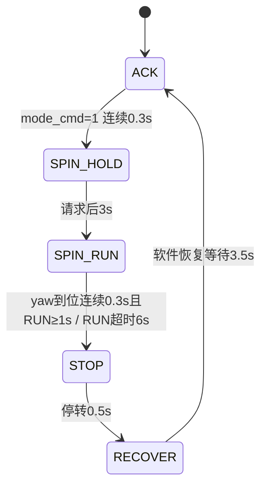

# 控制链审查（修改前基线，2026-11-06）

本报告依据工作区源码作静态审查和纯 Python 核心复现，未连接车辆、未运行 ROS 控制发布。行号指修改前版本。已有注释声称多轮修复，必须按实际执行代码判断。

后续实车确认更正：`/localization`和雷达均已是车辆几何中心，最终`body_to_base_link_x=0`；真实自转命令与反馈都是4，最终`spin_feedback_mode=4`。以下反馈2映射与-0.15补偿描述仅记录原代码基线，已被确认纠正；原反馈映射错误也是自转无法执行的直接原因之一。

## 1. 实际运行框架与接口

`car_launch/launch/run_rda_dwa.launch.py` 延时启动 `rda_dwa_real/launch/rl_dwa_car.launch.py`。后者实际启动 `bridge_node`、`lidar_track_node`、`traj_tracker_node` 和可选 `car_ctr`。旧 `control_bridge_node` 未启动、未列入 `setup.py` entry points，其 Python 文件在当前源码中不存在；yaml 中旧控制桥参数不起作用。

```mermaid
flowchart LR
    P[bridge_node / 局部规划] -->|/cmd_vel Twist v,w| T[traj_tracker_node 50Hz]
    P -->|/rda/traj Path map x,y| T
    P -->|/rda/spin_target Float32 目标yaw| T
    P -->|/rda/traj_mode Int32 0 ACK / 1 SPIN请求| T
    L[/localization Odometry body pose] --> T
    T -->|/car_cmd CarCtr| C[car_ctr 20Hz主循环]
    C -->|UDP SteerModeCtrl / Run| V[实车底盘]
    V -->|UDP Car / Wheel| C
    C -->|/car_state CarState| P
    T -->|/car_bridge_state Int32 软件FSM状态| P
    T -->|/rda/ctrl_status String| D[诊断记录]
```

- `/rda/traj` 是 bridge 在最终 `v,w` 上另做恒速积分的轨迹，不直接来自 DWA 已碰撞检测轨迹（`bridge_node.py:646-669`，`traj_predict.py:18-51`）。Path 中每个 pose 的 z 存 v，仅供诊断；yaw 姿态未填写，跟踪器只读取 x,y。
- tracker 的 pose 经 `body_pose_to_base_link(...,-0.15)` 补偿（`traj_tracker_node.py:169-178`）；地图frame硬编码/未验证必须由集成方保持一致。
- tracker 只用路径几何做纯跟踪，`w` 不直接决定阿克曼转角；`w` 主要参与停车分支及历史自转诊断。
- CarCtr 命令：`turnmode=0` 阿克曼，`speed` m/s、`angle` 度；`turnmode=4` 自转，`speed` rad/s、`angle=0`。car_ctr 对阿克曼 angle 取负，对自转 speed 乘 `-2`；此比例及符号须实测标定（`car_ctr.cpp:59-60,124-129`）。
- CarState 反馈编号不同：0 阿克曼、1 差速/中间态、2 自转、3 横移、4 斜行，映射逻辑在 `car_ctr.cpp:38-49`。不能将反馈2与命令2直接比较。
- `/car_bridge_state` 是 tracker 软件状态，不证明机械四轮模式就绪；0 ACK，1 切换挂起，2 软件 SPIN_RUN，STOP期3 reached/4 timeout。

## 2. 当前状态机（源码真实行为）



`traj_tracker_core.py:448-603` 中 SPIN_RUN 只按目标角 reached 或 timeout 退出，旧轨迹恢复/no_turn判据已退役；`606-625` 按 yaw 误差方向输出 `spin_w_max`，25度内线性减速、4度内停止，**不使用规划 w 决定自转速度**。`bridge_node.py:702-709` 在 SPIN_REQUEST 锁存目标角。

因此，当前版本不能将“切到自转但不转”直接归因于 `w=0`。复现 `v=w=0`、yaw=0、目标90度时，在SPIN_RUN输出 `turnmode=4,speed=1.0`。应检查部署版本、底盘实际ready、坐标yaw、角误差、单位和超时。

## 3. P0：机械切换时钟与控制状态不一致

证据：tracker在进入SPIN请求后仅等待 `spin_wait_time=3`（`core:567-573`）。car_ctr发 `SteerModeCtrl`并锁存，反馈到达锁存目标后执行 `delay_time.Clear()`，此后再次等 `mode_change_time=3` 才发 Run（`car_ctr.cpp:95-99,113-129`）。

典型时序（从模式请求已触发的时刻算起）：

| 时刻 | tracker | 底盘桥/车辆 |
|---|---|---|
| t=0 | HOLD，发mode4 speed0 | 发SteerModeCtrl4，轮子切换 |
| t=3 | 软件进入RUN，开始输出角速度；6s超时开始 | 若此时反馈到mode2，**重新清3s等待** |
| t=6 | 软件已消耗3s RUN | 首次实际发Run开始旋转 |
| t=9 | 软件RUN6s超时→STOP | 车实际最多只转约3s |
| t=9.5 | RECOVER，发mode0 | 又开始机械切回+反馈后3s等待 |
| t=13 | 软件回ACK | 可能尚未真正阿克曼ready |

反馈延迟更长时真实旋转时间更短；即便反馈3s恰好正确，转180度且减速也可能超时。不能仅增加固定timeout掩盖两个时钟。

优先修复：底盘桥发布实际命令模式ready和feedback freshness；切换时从首次请求起至少3s且目标模式反馈新鲜稳定后ready，或明确保留反馈后安全等待但让tracker等ready。tracker的RUN计时只在ready后开始，恢复也等ACKready。底盘bridge应独立停止和watchdog，在切换过程中禁止非零Run。请求锁存应有失败超时/故障状态，重复下发限频，防每20ms重发可能触发硬件重新开始动作（是否重置硬件需实测）。

## 4. P0：安全停止不能可靠终止自转；定位新鲜度无保护

- `traj_tracker_node.py:169-178` 保存 `_loc`，没有源timestamp或最近有效定位时间。`_control_tick:216-220` 只检查 `_loc is None`。曾经收到定位后即便定位冻结也继续运行。
- planner因碰撞/定位超时发 `v=w=0` 和默认traj_mode0，tracker在SPIN中忽略mode_cmd0，并且自转速度独立w。纯Python复现set_traj_mode(0)后仍输出speed1.0。这意味着“停车计划”不能自动取消当前自转（必须区分正常mode0与明确安全abort）。
- `/cmd_vel` 超时使用 `emergency_cmd()` 保持模式，但没有取消/冻结FSM时钟（`node:206-210`）。通信恢复后HOLD/RECOVER可按墙钟直接完成、RUN可超时；状态曾被急停中断却仍保留。
- `/rda/traj` 超时调用 `stop_cmd()` 总是发mode0（`node:211-215`，`core:229-232`），软件FSM仍SPIN，可能在底盘已切ACK或正反向切换时恢复发mode4非零速度。
- 当前node不检查 cmd/traj/目标/yaw/轨迹点finite、frame、源stamp、消息一致性，也未订阅真实模式反馈。
- 当前感知agent确认 `/localization` 50Hz会重发旧源stamp；应按源stamp推进验证，不能仅接收时间。源stamp门需兼容明确的仿真时间/初始化行为，不能把每帧重复消息当新定位。

优先修复：显式 `/rda/safety_stop` 或带会话的计划状态，所有模式安全停止均保持实际轮模式发0并取消会话，禁止缺省mode0成为安全语义；tracker独立源定位timeout+物理反馈timeout+输入finite验证；恢复运动必须新计划+新定位+ready，无条件保留旧FSM不安全。自转过程中持续做车体扫掠安全检测，安全abort优先于最小RUN时长。

## 5. P1：换根轨迹使用永久递增索引

`_nearest_index`（`core:330-354`）始终以 `max(self._nearest_idx,best)` 输出，下界不随新traj_seq重置。每个规划周期的Path从当前位置重新生成，索引单位是“该条新轨迹中的点序号”，旧序号没有跨轨迹空间意义。一旦旧轨迹索引20，下一条新根正确最近点0也输出20，可逐步累积至尾端，前视跳点、短路径回退、侧向误差异常。

纯Python复现60个x递增点、旧车位x=.4：idx20；new seq且车位x=0：仍idx20（正确为0）。

修复：同一条轨迹可单调推进；新轨迹从当前pose重新搜索/投影最近点，不继承索引下界。若要跨周期连续性，用几何投影或轨迹ID/时序一致路径，而非索引值。

## 6. P1：纯跟踪几何与已验证曲率不一致

`_lookahead_point_short`（`core:289-325`）在剩余弧长不足前视时取剩余2/3处点，但 `_pure_pursuit`（`387-443`）仍除以标称自适应lookahead²。标准纯跟踪应使用目标点实际平方距离 `dx²+dy²`。在速度.1m/s、3s路径仅约.3m时，目标距离约.2m却除以.675²，实际曲率可能仅应有值的约9%，转弯严重不足。另一方面跨根idx累积又使目标不稳定，形成“规划需要转→执行没转够→下周期改另一侧”的闭环震荡。

速度<.05时转角归零，然后经45度/s回中；.05附近启动/慢爬可反复打角。参数 speed_eps/speed_ramp_max/lookahead_v_gain/lookahead_max/spin_min_run 等只在core默认值，node未declare或加载，yaml调参不会生效（node:50-96）。节点wheelbase默认.46/maxsteer40也不同于core.69/30，当前yaml正确覆盖但无yaml启动存在危险配置漂移。

修复：实际目标几何纯跟踪，短/退化路径安全停止；过滤曲率/转角目标并保持执行器转角状态，steering rate统一参数化且碰撞预测考虑滞后；同向候选黏滞应在规划层实现。独立复核base_link是否车辆参考中心、Ackermann模型轴心一致。

## 7. P0/P1：减速远慢于规划假设

`_ramp_speed`（core:240-251）对加减速均使用 `speed_ramp_max=.2m/s²`，与planner `ack_dec_max=1.5` 不一致。目标从.8降到.1，1s后输出约.596；以.8→0、.2制动计算纯制动距离1.6m，而1.5只约.213m（另须加系统延迟/跟踪误差）。当前真0停车旁路可瞬时发0，但动态避障较低非零安全速度仍被延迟执行；发生提前制动时会持续高速侵入已判定风险区域。

修复：平稳加速与安全减速分开，降速立即跟随规划安全上限，或使用与规划一致且实测可靠的减速度上限；停止和风险停车优先于平滑。动态安全应基于实际速度/执行滞后计算制动包络，不能只检规划理想命令。

## 8. P1：现有“死区”和轨迹缓存未实现宣称平滑

- `_deadband_filter`（core:644-690）每tick更新ref，死区内仅输出上一tick输入，在50Hz保持一个规划指令若干tick时下一tick即完全跟上；转角又来自路径而非过滤后的w。这不是防来回转角的滞回滤波。
- `TrajTimeCache.add_cycle` 按 `(t,x,y,theta)` 插入全部样本，`query(now,same_dt)` 精确查询刚添加的本周期时间点，正常情况下完全返回最新轨迹。复现old y=1 / new y=-1、new now=.103秒后，query整条等于new。因此它通常没有平滑效果。重复t按x/y/角度tuple字典顺序选择，不按周期新旧；错开浮点或调用方式改变后可能插值历史/当前轨迹。
- 如果将缓存真正改成历史轨迹融合，融合后的曲线必须再次按车体与动态障碍预测校验；未经校验的几何平滑可穿入障碍物。更稳妥是禁用当前缓存并统一“已验证参考轨迹”来源。

## 9. 底盘协议其它工程风险

- car_ctr无 `/car_cmd` watchdog，收到非零Run后上游完全停止时没有定时Stop/Run0；heartbeat字段被忽略，enable、source、ctr_mode也未作为下发门。必须由底盘独立最后一级watchdog兜底（core上游50Hz不能代替）。
- UDP Wheel分支只检查substrs非空后访问at(2)，残缺包可抛异常中断进程（car_ctr.cpp:227-235）；Car消息atoi未验证取值。状态未标记新鲜度、默认speed0可误导上游。
- TTimer用gettimeofday（public.cpp:295-311），墙钟调整可影响等待；应为steady_clock/monotonic。
- tracker号称50Hz，但car_ctr主循环20Hz、spin_some队列10，每轮可能集中处理多条命令；机械下发需要清晰rate/last-command纪律。

## 10. 修复优先级与验收建议

1. 统一实际ready反馈+3s切换协议，底盘与tracker安全watchdog，安全abort跨模式优先，定位源stamp有效性。
2. 消除换根索引下界、修正实际几何纯跟踪，分离平稳加速和及时减速；禁用未验证缓存。
3. 上层仲裁基于真实低速/位移+无法前进证据+目标角误差+完整旋转扫掠安全，自转会话结果握手；动态让行不得解释成trap。
4. 一条安全轨迹经规划、发布、执行保持一致，加入执行器/感知延迟与制动包络。
5. 离线回归至少覆盖：w0但角误差90度正常旋转、3s实际ready延迟、从SPIN定位冻结/感知异常安全停止、切换中轨迹超时不反复模式切换、新根idx归0、短曲线纯跟踪曲率、非零目标降速及时响应、一次自转reached/timeout结果不丢失。

实车验收用diag/rosbag对齐 `/localization` 源stamp、`/car_state` 实际模式、`/car_cmd`、`/car_bridge_state`、目标yaw误差和轮速；需要先校准自转speed→yaw_rate比例及符号，再判断timeout范围。缺少实车数据时无法宣称动静避障已可靠。
