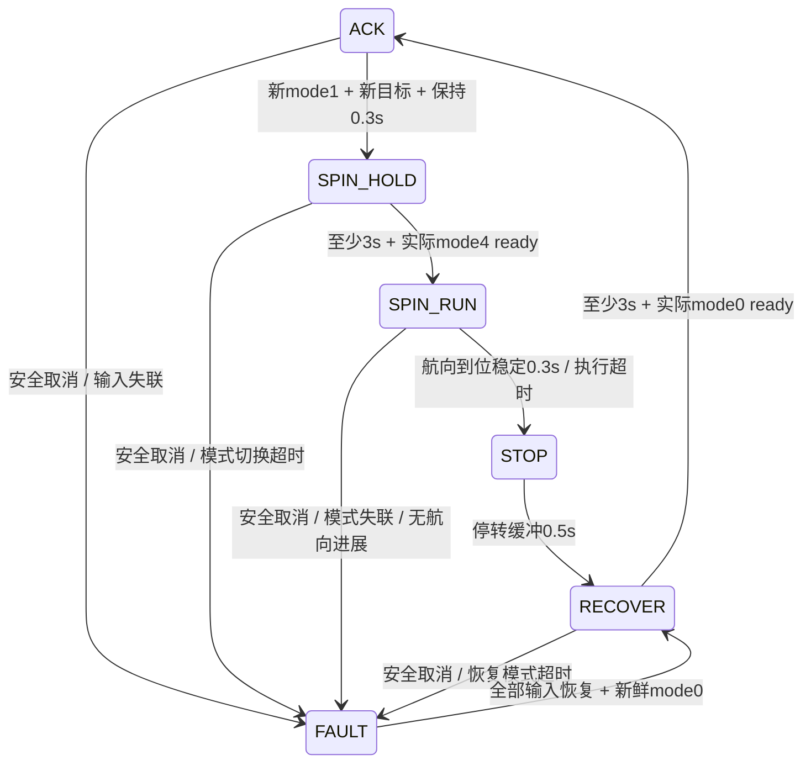

# 控制修复实现与离线验证（2026-11-06）

## 已实现的行为

实际控制链仍是 `bridge → traj_tracker → car_ctr → 底盘`。实车已确认1.2×0.8m、轴距0.69m，/localization本身就是几何中心，雷达也居中，所有body_to_base_link_x取0（去除原-0.15m重复补偿）；默认 ACK 控制改为执行规划已验证的前馈曲率，保留经修正的纯跟踪几何作为可配置反馈备选。`tracking_correction_max_deg=0` 时，目标转角是 `atan(w*L/v)`；可选反馈修正被这个参数限制。启动非零修正前需要将它造成的轨迹偏差纳入碰撞预测并完成实车跟踪误差验证，本轮没有证据支持默认开启。

ACK安全停车、普通零速度和FAULT恢复保持最后已发送的ACK角及已保持目标，不在车辆可能仍有制动速度时瞬时回中；没有实测静止反馈时不自行回中。转角目标设置真正的小变化保持：以已保持的目标角为基准，小于 `steer_hold_deg` 的波动不更新；慢变累积越阈值会更新，随后按参数化角速度上限输出。不同重规划轨迹重置最近点下界，同一轨迹允许单调前进。生产Path携带几何中心(x,y,yaw)，纯跟踪备选将定位与Path按沿车头-0.345m转换到后轴点，再用实际前视距离平方计算；前进接受前方参考，倒车接受车后参考，拒绝运动方向不符或退化路径。负速度保留delta=atan(w*0.69/v)的符号，反向travel-heading的曲率与物理转角映射已适配。加速温和；任何较低规划安全速度上限直接生效，不被死区或缓慢降速滤波延迟。`dec_lin_max` 供与规划制动能力统一配置，控制发送安全降速上限时不会把它当作延迟执行的理由；实际物理减速度仍须车辆标定。

## 原子参考接口

新增 `/rda/command`，类型 `geometry_msgs/TwistStamped`。它与 `/rda/traj` Path 使用同一规划周期捕获的 `header.stamp` 和 `header.frame_id=algorithm_frame`。控制接收端以整数纳秒epoch配对，只有完整同epoch命令与路径才原子更新 v/w/Path；有限pending队列容量4，已提交及更旧epoch不覆盖当前参考。未齐的下一周期参考保持上一完整周期，且不刷新源时间或watchdog年龄；未来/过期epoch不会毒化队列。

`/cmd_vel` 继续订阅用于兼容诊断，不能独立覆盖控制参考。`/rda/traj_mode=-1` 是独立安全取消，不等待参考配对。Float32自转目标仍由上层会话锁存；tracker在初次 mode1 到达后至少等待一次新的目标到达，再累计进入保持时间，并在会话内本地锁存角度。目标/模式尚未改为单个带epoch消息，因此这个到达时间门是明确的适配策略，DDS全链时序仍需ROS集成验证。

## 模式就绪和自转状态机

`car_ctr`新增 `/car_mode_ready` Int32：`-1` 未就绪（包括反馈失联、无有效命令），`0` 阿克曼就绪，`4` 自转就绪。20Hz发布的心跳由底盘桥计算，依据是“首次机械请求后至少3秒，且最新有效Car模式反馈与锁存目标匹配”。反馈到达不会再清零计时。CarState的自转反馈编号由spin_feedback_mode配置，用户最终确认反馈4映射命令4，默认spin_feedback_mode=4且只认可反馈4，反馈2不能同时放行。



SPIN_RUN转速由本地锁存的目标角与最新有效yaw误差产生，独立于阿克曼规划w，近目标减速并限制角加速度。RUN timeout在实际ready后计时；另外具有模式等待timeout和无yaw进展timeout。正常 mode0 不是“已转到位”的证据，不能中断正在执行的正常会话；明确危险用mode-1。

安全停车保留当前请求的轮模式，立即输出0，禁止以轨迹超时切ACK而软件FSM仍为SPIN。安全错误进入FAULT，持续上报`/car_bridge_state=4`，旧重复mode1不能重入。必须恢复新鲜有效输入且收到mode0才零速请求ACK，等待实际ACKready后恢复。到位3和超时4在STOP、RECOVER全过程持续上报，防止低频planner漏读短脉冲。新一次SPIN必须经过mode0重新允许后再请求1。

## 时间与底盘保护

控制节点另加独立PoseContinuityGuard：相邻有效源stamp的位移不超过pose_speed_limit·dt+.15m、yaw变化不超过pose_yaw_rate_limit·dt+5度（dt最大取1秒，裕度均参数化），第一帧定位不设跳变门，正常.8rad/s、10Hz自转及±π跨界可通过。位置或yaw超门后在node级锁存故障，拒绝这个位置，也拒绝后续连续新stamp在新map偏移下的自动解除，立即FAULT保持轮模式停车并上报4，不将定位跳变当自转到位。诊断增加pose_fault_latched与localization_position_jump/localization_yaw_jump原因。

**运行中重定位流程：先停止车辆，再重定位，确认新map坐标正确，然后重启局部规划与控制链并重新给目标。** 不能仅重发mode0恢复这个连续性故障；节点重启会创建新的连续性基线。阈值内的小地图修正无法仅靠物理连续性门完全识别，若后续增加显式定位reset/epoch信号，应同步丢弃旧参考和目标。

控制节点按源定位stamp推进以及本地接收时间双重验证；旧源stamp被高频重发不能刷新有效年龄。命令/路径按完整参考epoch检源年龄与到达年龄，模式/目标/ready各有独立到达watchdog，frame、坐标、命令和目标finite均有校验。初始化输入尚未到齐时停止等待，不把正常启动等待报成一次自转失败。

底盘发送增加独立命令与Car反馈watchdog；失联、无效命令、enable=0或非程控时发零运动指令。模式发送前停车，机械请求锁存，SteerModeCtrl初次立即发送，后续按mode_retry_period补发（默认机械等待+.5秒，即3.5秒，参数必须不短于机械等待）；若新鲜Car反馈处于已知切换中间态1，则不补发以免重新启动机械动作，切换失败由tracker独立8秒超时停车。补发后必须再次满足完整机械等待，不能因为距初次请求已超过3秒就提前运动。只有模式ready门通过后可发送运动Run。Wheel残缺字段、ID、数值和各轮有效年龄有检查；无效轮速用NaN明确表示，不能被Car心跳刷新。等待和watchdog用steady_clock，避免墙钟调时影响模式计时。`std_msgs`补进car_ctr显式target依赖。

新增诊断保留原控制字段，并增加`physical_ready`、`fault`、`cmd_age`、`traj_age`、`loc_age`、`loc_source_age`、`mode_age`、`target_age`、`ready_age`、`ref_epoch`。

## 参数接线

所有 `TrajTrackerParams` 字段由ROS节点自动声明并读取，核心统一验证有限、正值及机械等待关系（spin_wait_time/recover_delay至少3秒，switch_timeout大于等待），消除core参数在yaml中不起作用的问题。与规划agent协商的主要参数：

| 参数 | 保守默认值 | 用途 |
|---|---:|---|
| acc_lin_max / dec_lin_max | 0.5 / 1.5 | 平稳加速和规划制动能力口径 |
| steer_rate_deg / steer_hold_deg | 45 / 0.25 | 转角变化率和真正的小波动保持 |
| tracking_correction_max_deg | 0 | 已验证前馈曲率之外的最大反馈修正 |
| spin_wait_time / recover_delay | 3 / 3 | 最少机械等待，还必须实际ready |
| switch_timeout | 8 | 机械模式切换最大等待 |
| ready_timeout | 0.3 | 底盘ready心跳最大年龄 |
| spin_timeout | 12 | 实际RUN后的最大执行时长 |
| spin_progress_timeout / spin_progress_deg | 2 / 0.5 | 无实际航向进展检测 |
| spin_w_max / spin_acc_max | 0.8 / 0.8 | 自转角速度与角加速度上限 |
| localization_timeout / mode_timeout / target_timeout | 0.5 / 0.5 / 0.5 | 独立输入有效性 |
| v_min / reference_center_to_rear | -0.3 / 0.345 | 倒车下限与中心到后轴距离 |
| direction_zero_hold / direction_speed_eps | 0.2 / 0.03 | 换向和首次倒车静止确认 |
| speed_feedback_timeout | 0.3 | 有效四轮反馈最大年龄 |
| pose_speed_limit / pose_yaw_rate_limit | 0.8 / 0.8 | 定位连续性物理速度上限 |
| pose_jump_margin / pose_yaw_jump_margin_deg | 0.15 / 5 | 定位位移与航向跳变裕度 |
| body_to_base_link_x | 0 | 定位与雷达已居中，无额外-0.15m补偿 |
| spin_feedback_mode（底盘） | 4 | 精确确认的自转反馈编号，仅接受4 |
| command_topic / mode_ready_topic | /rda/command /car_mode_ready | 新的参考与实际就绪接口 |

倒车已获实车支持确认，速度范围由v_min=-.3与v_max限定，仅执行planner验证通过的后向轨迹。前后换向先保持零速，并要求有效四轮反馈均值绝对值≤.03m/s稳定.2秒，首次负速度起步也必须此握手；缺失反馈保持停止。CPP记录四个Wheel分别收到有效数值的时间，某轮过期时在CarState发布中将其speed标为NaN，不能用新Car心跳夹带默认/旧零轮速假装静止。node要求四轮finite并拒绝显著混合正负轮速，再给core签名轮速反馈。倒车安全降速按速度幅值即时执行，加速按.5m/s²增加负速度幅值。CPP原阿克曼Run协议直接传负线速度，无需新模式。

cmd/traj等时限可由统一yaml覆盖；增加时限不能替代动态障碍迟滞验证。转角hold造成的0.25度误差、执行器滞后、测量误差仍要计入规划安全裕度。用户已确认自转UDP `-2` 标定与转向符号正确，反馈表示四轮机械到位。确切CarState自转编号由spin_feedback_mode参数指定（用户已精确确认/car_cmd=4且/car_state=4，默认4），不能同时把2/4都当自转就绪。

## 验证证据与边界

已通过45项Python离线回归，包括33项控制状态/运动几何/参数校验/定位连续性/倒车握手、2项参考配对、10项ROS适配器消息契约。适配器使用消息stand-in，不启动ROS/DDS。C++纯状态机头独立编译并执行单次3秒等待、模式映射、旧反馈禁止运动、切换锁存、补发间隔/补发后完整等待及切换中不重启动作断言。Python运行代码语法编译通过。

复现命令：

```bash
python3 -m unittest discover -s tests -p 'test_control*py' -v
clang++ -std=c++17 -Wall -Wextra -Wpedantic tests/test_mode_switch_guard.cpp -o /tmp/test_mode_switch_guard
/tmp/test_mode_switch_guard
python3 -m py_compile rda_dwa_real/rda_dwa_real/traj_tracker_core.py rda_dwa_real/rda_dwa_real/traj_tracker_node.py
```

本机无ROS2，**未声称car_ctr完整ROS构建、DDS跨话题时序测试或实车验收通过**。未连接车辆、未启动任何真实UDP控制。还需要ROS环境构建与开阔低速实车标定，特别是生产ROS时序、已确认中心运动学的闭环性能以及避障安全包络。
