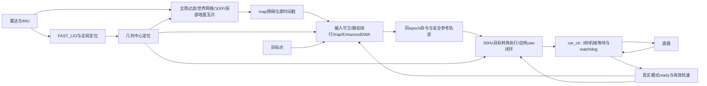

# 无人车避障修复与验收

日期：2026-11-06。运行入口保持 `ros2 launch car_launch run_rda_dwa.launch.py`。

本次完成了多 agent 分段审查、接口交叉核查、问题文档、源码修复及统一离线验证。原代码存在明确的运动、几何、预测和机械模式时序缺陷，不能仅凭检测准确就判断避障可靠；本次针对这些缺陷作了工程修复。**已经完成的是源码与离线验证，尚未完成车机 ROS2 构建、DDS/rosbag 回放和实车验收。**

## 1. 与四个实车问题的对应结论

| 实车问题 | 已定位原因 | 修改后行为 |
|---|---|---|
| 航向抖动、左右打方向 | 换根路径继承旧最近点索引；短路径前视距离分母错误；采样可能没有直行；原死区只延迟一帧；代价归一化放大小变化；规划和执行曲线不同 | 新路径重定位；修正实际几何；包含零转角；实际转角保持与45°/s限速；固定物理尺度评分；参考与命令同epoch配对，按同一目标转角/执行器速率预测和执行 |
| 切到自转但未转完就切回 | **本车反馈4被原程序映射为斜行1，原程序却期待反馈2**；底盘反馈到位后又重新等3秒，而tracker已经开始RUN超时 | 严格指令4/反馈4；首次请求后至少3秒且实际ready才RUN；目标锁存；yaw误差独立生成自转速度；到位稳定后才恢复ACK，超时/危险单独上报 |
| 动态/静态避障是否可靠 | 预测位置没有进入矩形撞检；未来不可行后按当前位置放宽；感知只看前方；重复旧帧与TTL错误；冷启动预测与实车不一致 | 全周12米；源时刻/真实初态；车辆与障碍同t足迹检查；响应、制动和停车后的完整时域；失联安全停车；未知初速度可达域；静态早绕行；U墙保留空腔 |
| trap与控制模式频繁切换 | 低速帧数直接触发；子目标每帧重生成；0.2米子目标/0.3米退出冲突；机械等待期仍累计；超时退出恢复自转许可 | 持续实际无进展门；侧向/目标进展识别；子目标/逃逸侧锁存；切换期冻结；可安全回全局方向才退出；冷却5秒、同一问题最多2次；重复请求与失败会话去重 |

阿克曼在 `v=0` 时输出 `w=0` 是正常约束。审查时的源码已经包含部分自转yaw闭环修复，因此这次没有再次把一切归因于 `w=0`。用户确认的反馈编号不一致及两个3秒时钟，才是不能正常自转的重要直接原因。

## 2. 最终实车参数与框架

用户最终确认：车长1.2米、宽0.8米、轴距0.69米；当前定位点已经是几何中心，雷达平面原点也在该中心；支持倒车；自转指令和反馈都是4，反馈表示四轮已经到位，UDP自转速度乘-2及正负方向已实测。

按用户后续要求，定位算法保持原样，补偿最终归零。`global_localization.py`、`transform_fusion.py`及FAST_LIO的`CMakeLists.txt`已与原始备份逐字核对一致；定位部分仅保留body→base_link静态TF的x=0，感知、规划、跟踪三处`body_to_base_link_x`同步为0。原ICP、初始化、保存/加载和定位发布逻辑沿用原代码。下游的源时间戳有效性与异常输入停车检查继续保留。

| 参数 | 最终配置 |
|---|---|
| `body_to_base_link_x` | **0**，删除旧-0.15米重复补偿；静态TF同步 |
| 车身与旋转中心偏移 | **0** |
| `reference_center_to_rear` | 0.345米，供后轴运动学转换；这是轴对称默认假定，若后轴实测不同需同时改规划与跟踪 |
| 前进/倒车上限 | 0.4 / -0.3 m/s，先低速复验 |
| 线加速度/制动模型 | 0.5 / 1.5 m/s² |
| 前轮最大转角/转角速率 | 30° / 45°每秒 |
| 自转角速度/角加速度 | 0.8 rad/s / 0.8 rad/s² |
| 模式切换/补发间隔 | 至少3秒 / 默认3.5秒；补发后重新满足完整机械等待 |
| 预测/响应包络 | 3秒时域、0.05秒步长；0.6秒响应包含参考watchdog及调度余量 |
| 感知/参考有效性 | 默认0.5秒；底盘命令和反馈watchdog 0.3秒 |
| 自剔除 | 实际1.2×0.8米盒，外扩0；不屏蔽车外2厘米侧墙 |

控制的纯跟踪反馈修正上限默认0，优先执行经验证的目标转角；规划本身持续接收位姿反馈重规划。修正后的纯跟踪几何仍保留，启用额外修正前要验证它改变的轨迹与安全包络。斜行/平移未纳入本轮执行协议，当前生产运动为阿克曼前进、经后方检查的倒车，以及独立原地自转。



规划预测从当前带符号速度、实际已发送转角开始，逐步达到目标转角。几何中心先转换到后轴积分，再回到中心，避免把中心点当后轴直接积分。正负换向先停车，四轮有效反馈确认零速并稳定0.2秒才反向加速；Wheel缺失/过期明确输出NaN，Car心跳不能把默认0当真实静止。

静态路障提前锁定一侧与前后阶段点，DWA仍验证每条实际连接曲线；引导点没有替代碰撞证明。大/凹点云簇拆成世界固定局部AABB，父对象继续估计运动，动态子片继承速度及未知可达域。U形墙的空闲内部不再被单个大框填满；超512片时明确失效停车，不删掉远处点或粗合并空腔。

## 3. 验证结果

初始避障修复验证为127条Python回归和8个子测试。本次诊断增强又增加44条回归，**当前完整验证为171条Python回归、12个子测试通过**；实际YAML的三个运行节点构造/参数声明与读取检查通过；C++机械模式策略独立编译及断言通过；51个Python/launch/验证源文件语法通过。

离线闭环使用实际YAML、50Hz跟踪器、有界加减速/转角执行器，初始ACK已经就绪。它不启动ROS或UDP，不能替代实车动力学识别。

| 场景 | 结果 | 模拟时间 | 最小保守圆包络净距 | 模式切换请求 |
|---|---|---:|---:|---:|
| 空地4米目标 | 到达；无转角反号 | 12.18秒 | 无障碍 | 0 |
| 0.6米方路障绕行 | 到达；1次正常S弯反号 | 18.54秒 | 0.643米 | 0 |
| 1m/s行人横穿 | 到达 | 12.58秒 | 0.409米 | 0 |
| 后方2米目标 | 安全倒车到达 | 8.02秒 | 无障碍 | 0 |
| 后方近障碍挡住倒车 | 保持停车 | 3秒观察窗 | 0.117米 | 0 |

全部场景最大命令转角速率不超过45°/s。表中的圆包络比静态矩形更保守，后方受阻是要求停车的成功结果，不是要求强行到达。

独立自转闭环验证全程规划 `w=0`：0.28秒请求模式4，3.28秒才开始旋转；6.18秒到位稳定后停转，6.68秒请求ACK，9.68秒恢复ACK；最终误差3.92°，只发生4→0这一轮切换。过程中普通mode0没有把未转完的会话当成已完成。

原始U墙反例：247点连为一个簇，旧整体bbox把车心误判碰撞；新26个静态局部框保全点覆盖，车心无碰撞且核心可输出前进。厚U、窄U、近侧壁、旋转后的世界瓦片ID/速度、动态长簇继承速度、未知首帧/遮挡及上限失效也有回归。**这证明指定表示反例被修正，不证明任何迷宫都能脱困。**

本机性能：典型闭环规划p95约18～30ms；26个U墙局部框单步约160ms。完整纯感知80k密集点约234ms、100k约250ms，80k长墙约83ms。以上未包含ROS解码、DDS及车机CPU争用，**不能承诺全场景10Hz**。新增诊断记录`planning_duration_s`、真实`cycle_dt_s`与`planner_dt_s`；日志不再用计算耗时倒数冒充实际循环频率。

完整记录：[统一摘要](validation/validation_summary.json)、[验证日志](validation/validation_run.log)、[闭环结果](validation/closed_loop_results.json)、[自转结果](validation/spin_session_results.json)、[感知性能](validation/perception_performance.json)。

修改补丁已在工作区之外的临时目录对94份原始源码完成试应用；25份修改与15份新增代码/验证源均与最终源码SHA-256一致。记录见[补丁一致性检查](validation/review_patch_result.json)。

## 4. 构建与实车复验

源码修改必须整体部署，不能只替换tracker或只替换底盘桥。新接口为`/rda/command`和`/car_mode_ready`；原`/cmd_vel`保留诊断，已不单独覆盖控制参考。

在原来已经可以运行该launch的车机ROS2工作区、外部传感器/FAST_LIO依赖已安装的前提下重新构建：

```bash
colcon build --symlink-install --packages-select common control_msgs rda_dwa_real_msgs rda_dwa rda_dwa_real car_ctr car_launch
source install/setup.bash
ros2 launch car_launch run_rda_dwa.launch.py
```

定位包沿用现有实车环境，以上构建命令覆盖本轮改动的避障、控制和启动包。RViz障碍框与map轴对齐的实际碰撞几何统一，运动方向不再误旋转长宽包围框。

本机没有ROS2，因此上述构建/实车启动未执行。离线验证需要Python、numpy、PyYAML、pytest及C++17编译器，可复现：

```bash
bash docs/validation/run_all.sh
```

实车按以下顺序验收，并保留默认诊断记录：

1. 确认`/car_cmd`只有tracker发布，定位/点云源stamp推进，TF与参数平面补偿均为0，模式4反馈也为4。
2. 开阔低速直行、左右转弯与停车，核对真实转角响应、制动能力、参考跟踪误差和规划/感知p95/max耗时。
3. 阿克曼单块绕行；前后受限但旋转净空充足时，验证至少3秒后才自转、真到位后切回、失败有明确原因。
4. 倒车前后障碍、换向零速保持；行人横穿、起步、短遮挡及模式等待期间接近，检查时间足迹和安全停止。
5. 断流、Wheel缺失、模式反馈丢失、定位重置及复杂墙面；检查不假清场、不假零速、不留旧自转会话、不频繁重启trap。

严重定位跳变会锁存停车。恢复应先可靠停止、重新确认全局位置，再重启局部感知/规划/控制链以重建地图坐标下的状态和目标；单纯重发mode0或新时间戳不会解除这个故障。

仍需实测后轴相对中心距离、制动/转角动态、雷达z/倾角、有效量程与遮挡。当前是2D足迹和固定z过滤，低矮障碍/坡道需核对点是否被保留；匀速及有限未知速度上界无法证明任意突然奔跑/换向都安全。局部绕行与有限trap恢复也不代替全局路线规划。这些是可靠性结论的实际边界。

## 5. 文档与修改对照

- [原框架、数据流与问题定位](review/系统框架与问题定位.md)
- [最终规划与接口实现](review/implementation.md)
- [控制状态机实现](review/control_implementation.md)
- [定位、感知与U墙表示实现](review/perception_implementation.md)
- [跨模块交叉复核](review/cross_review.md)
- [原论文与官方工程依据](review/literature.md)
- [实车日志记录与分析指南](实车日志记录与分析指南.md)
- [算法客观理解与论文检索agent任务书](算法客观理解与论文检索任务书.md)
- [源码修改补丁](review/changes.patch)与[原始源码备份](review/baseline_sources.zip)

修复依据分别采用DWA的安全停车可行性、动态障碍相对运动、RPP的执行几何/速度约束和旋转进入退出滞回；保留并修正现有算法结构，没有用学习模型替代安全校验。各来源与本车工程推导的区别见文献文档。
